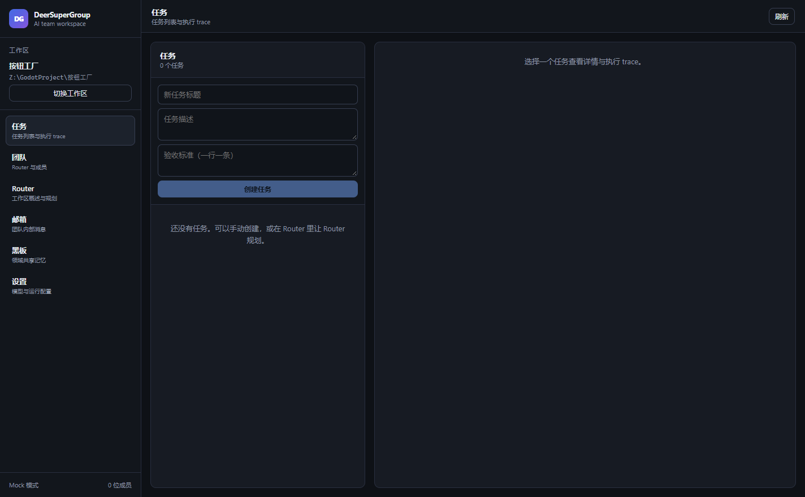
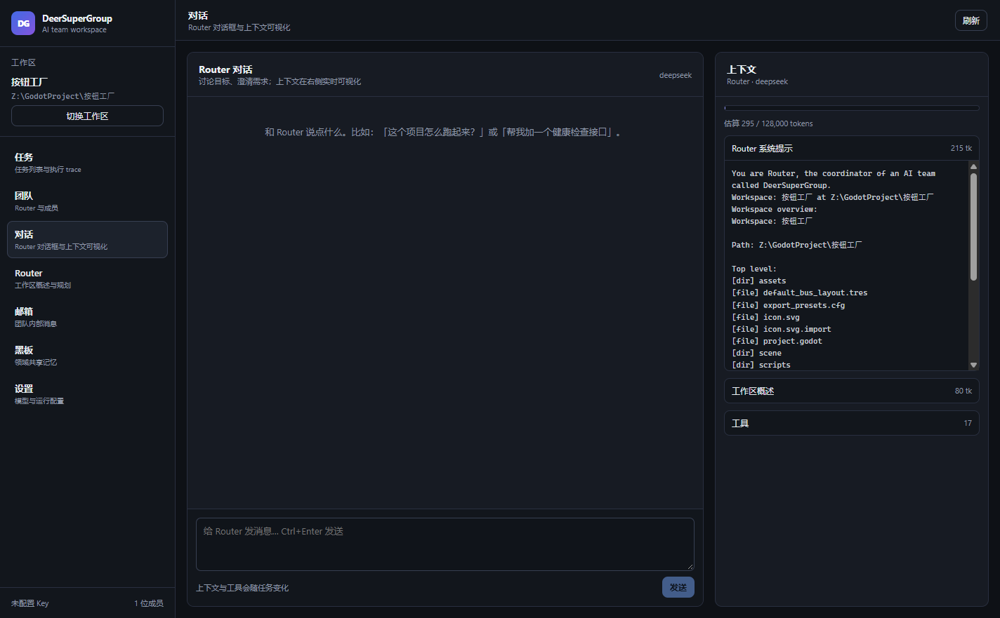
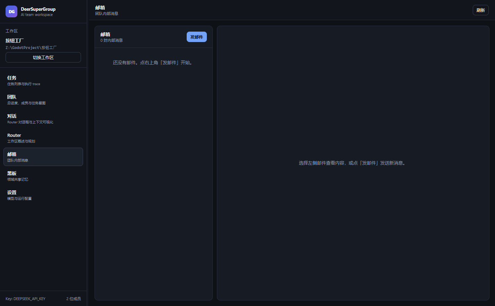
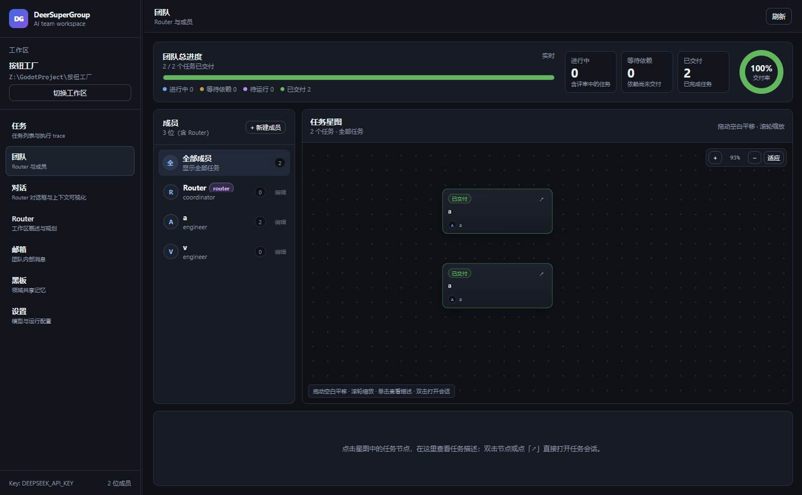
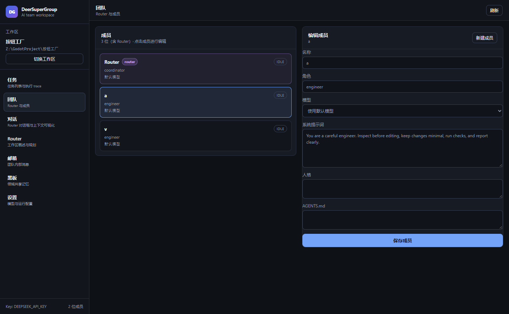
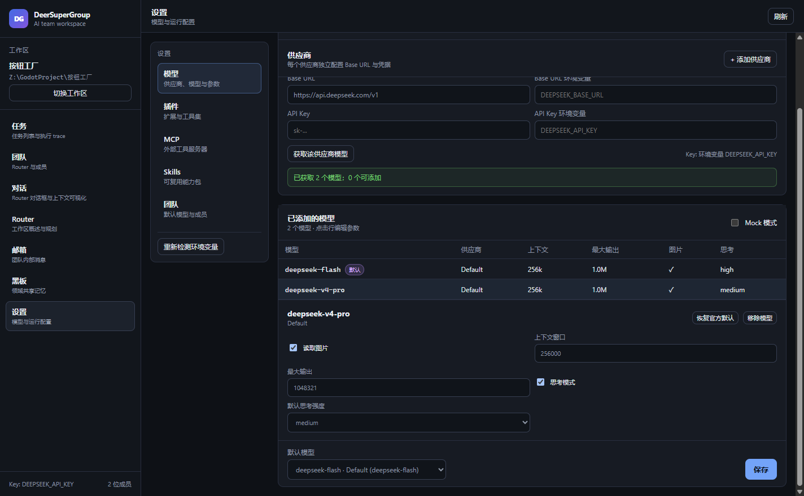

# DeerSuperGroup

[](LICENSE)
[](https://github.com/DeerLuuu/deer-super-group)

**一个本地优先的 AI 团队工作台**：Router 拆任务，成员在独立工作区里执行，邮箱与黑板共享上下文，人类负责决策与验收。





当前是 **P0 walking skeleton**：已经能打开工作区、创建成员、规划/创建任务、运行 Agent Loop，并把执行过程写入可回放的 trace。

---

## 已实现

- **本地桌面 App**：Electron + React + TypeScript。
- **工作区**：选择任意文件夹，自动创建常驻 `Router`，生成工作区概述。
- **成员**：名称、角色、系统提示词、人格、`AGENTS.md`、模型。
- **任务**：手动创建（弹窗），或让 Router 按目标规划成带依赖的任务（弹窗）。
- **Agent Loop**：流式模型输出、工具调用、最大步数、取消、结构化摘要。
- **内置工具**：
  - `fs.list` / `fs.read` / `fs.write` / `fs.search`
  - `shell.run`
  - `git.status` / `git.diff`
  - `task.list` / `task.get` / `task.complete`
  - `mailbox.send` / `mailbox.list` / `mailbox.read`
  - `board.post` / `board.list`
  - `memo.write` / `memo.search`
- **Router 对话框**：流式对话、停止生成；对话记录持久化。
- **对话控制条（方案）**：输入框下方直接切换当前成员的模型与权限（仅查看 / 工作区内修改 / 完全权限 / 自动风险投票）。另有参考 `dsh-full-throttle` 的 **Full Throttle（满血模式）**：会话级注入高预算/no-holds-barred 提示，只影响努力与预算，不改变任何工具权限。方案见 [DESIGN.md](DESIGN.md) §15。
- **深度思考展示**：DeepSeek 的 `reasoning_content` 会流式显示在可折叠的「深度思考」面板里，并随消息保存。
- **Markdown 渲染**：模型回复支持标题、列表、代码块、表格、引用、链接等 GFM Markdown；原始 HTML 会被丢弃，避免注入。
- **上下文可视化**：系统提示、人格、`AGENTS.md`、工作区概述、任务上下文、对话历史、黑板/备忘录、工具列表与 token 估算。
- **执行 trace**：每次运行写入事件日志，任务详情里可回看。
- **邮箱**：左右分栏，左侧邮件列表、右侧邮件详情；点「发邮件」打开弹窗，填写收件人、主题、类型与正文。

  
- **黑板**：按领域发布 entry（fact / decision / question / warning / artifact / link），发布通过弹窗。 
- **团队投票（方案）**：正式 poll 支持单选/多选、最多选择数、`>N`/多数/比例阈值、quorum、截止时间、改票与关闭审计；结果可生成黑板 decision，采纳项可转任务。方案见 [DESIGN.md](DESIGN.md) §14。
- **表单弹窗化**：新建任务、Router 规划、发邮件、发布黑板条目都使用二级弹窗，不占用主界面空间。
- **离线 Mock 模型**：不配置 API Key 也能跑通完整闭环。
- **OpenAI 兼容模型**：在「设置」里填 Base URL / API Key / Model。
- **模型列表**：设置页会自动请求 `GET {baseUrl}/models`，也可以手动刷新；获取后可逐个添加到「已添加的模型」。
- **团队驾驶舱**：顶部是总进度（进行中 / 等待依赖 / 待运行 / 已交付 + 交付率），中间左侧成员列表、右侧任务星图，底部显示选中任务的描述。
- **任务星图**：无限画布，可拖动平移、滚轮缩放、一键适应；单击节点查看底部描述，双击节点或点「↗」打开对应任务会话。

  
- **可拖动侧栏**：左侧边栏与主面板之间可以拖动调整宽度；双击分隔条恢复默认 250px，宽度会记住。
- **可拖动对话/上下文分栏**：对话区与右侧上下文之间也有一条分隔线；默认上下文 390px，双击恢复，宽度会记住。
- **上下文面板可隐藏**：对话标题栏提供「隐藏上下文 / 显示上下文」按钮，状态会记住；隐藏后对话区自动占满宽度。
- **设置分区**：设置页分为「模型 / 插件 / MCP / Skills / 团队」；模型页采用供应商 + 模型表 + 详情面板的结构。
- **多供应商 / 多模型**：可以添加多个供应商，每个供应商独立配置 Base URL、API Key 与环境变量；模型统一显示在「已添加的模型」列表里。
- **单模型参数**：点击模型行展开，单独设置是否读取图片、上下文窗口、最大输出、是否开启思考模式、默认思考强度。
- **成员模型**：创建/编辑成员时只能从全部已添加模型的下拉列表选择，不支持手动输入；选项会显示供应商名称。
- **成员编辑**：点击成员卡片选中，右侧可编辑名称、角色、模型、系统提示词、人格与 `AGENTS.md`。

---

## 快速开始

要求：Node.js 24+、pnpm、Windows/macOS/Linux 桌面环境。

```bash
pnpm install
pnpm dev
```

如果 Electron 二进制下载失败（GitHub 访问受限），可以先设置镜像再重装：

```bash
# PowerShell
$env:ELECTRON_MIRROR = "https://npmmirror.com/mirrors/electron/"
pnpm install
```

生产构建并启动：

```bash
pnpm build
pnpm start
```

测试与类型检查：

```bash
pnpm test
pnpm typecheck
```

---

## 使用流程

1. **打开工作区**：选择你的项目文件夹；Router 会自动生成工作区概述。
2. **创建/编辑成员**：到「团队」，点「+ 新建成员」或成员旁的「编辑」，在弹出的窗口里填写名称、角色、模型、系统提示词、人格与 `AGENTS.md`。

   
3. **规划或建任务**：
   - 到「Router」点「规划任务」，在弹窗里填目标；
   - 或在「任务」里点「新建任务」，在弹窗里填标题、描述与验收标准。
4. **运行任务**：选中任务，点击「运行任务」。任务依赖未完成时会拒绝运行。
5. **看 trace**：任务详情下方是执行片段（助手消息、工具调用、工具结果、完成/失败）。
6. **和 Router 对话**：到「对话」页直接交流；右侧「上下文」面板会展示当前生效的系统提示、工作区概述、历史、黑板/备忘录、工具与 token 估算。
7. **看任务上下文**：任务详情里点「查看上下文」，会带着该任务跳到对话页，右侧显示这次任务实际会用的提示词与任务信息。
8. **用邮箱与黑板**：成员可通过 `mailbox.send` / `board.post` 共享上下文；你也可以在 UI 里点「发邮件」「发布条目」在弹窗里操作。

> 没有成员时无法运行任务——这是刻意设计：Router 不直接干活。

---

## 模型配置

默认是 **Mock 模式**，完全离线、确定性执行，用于演示与测试。

要接真实模型：

1. 打开「设置」；
2. 取消勾选「使用 Mock 模式」；
3. 填 OpenAI 兼容的 Base URL、模型名；
4. 选择 API Key 来源：
   - **直接填写**：Key 保存在本地 SQLite；
   - **读取系统环境变量（推荐）**：只保存变量名，Key 不进入数据库。
5. 保存。

示例：Base URL `https://api.deepseek.com/v1` + 环境变量 `DEEPSEEK_API_KEY`；模型从「获取模型列表」里选（具体 ID 以你账号当前返回为准）。

Base URL 也支持环境变量：

- 默认自动尝试 `DEEPSEEK_BASE_URL`、`OPENAI_BASE_URL`、`OPENAI_API_BASE`；
- 设置页可以指定一个自定义变量名；
- **Base URL 环境变量优先于本地填写的 Base URL**。

API Key 默认自动尝试 `DEEPSEEK_API_KEY`、`OPENAI_API_KEY`，也可以指定变量名。

### 设置分区

设置页左侧是分区导航：

- **模型**：供应商、模型列表、单模型参数；
- **插件**：扩展与工具集（入口已就绪，插件运行时待接入）；
- **MCP**：外部工具服务器（入口已就绪，MCP 客户端待接入）；
- **Skills**：可复用能力包（入口已就绪，Skill 扫描/注入待接入）；
- **团队**：默认模型与成员概览。

### 多供应商与单模型参数



模型页支持多个供应商：

- 每个供应商有独立的 Base URL、Base URL 环境变量、API Key、API Key 环境变量；
- 点「获取该供应商模型」请求该供应商的 `GET /models`；
- 返回的模型以 chips 形式出现，逐个添加到全局「已添加的模型」列表；
- 同一个 model id 来自不同供应商时，会以 `providerId:modelId` 区分，不会互相覆盖；
- 点击已添加的模型行，展开该模型的参数。

每个模型可单独设置：
  - 是否读取图片（模型能力标记，供后续多模态输入/路由使用）；
  - 上下文窗口（默认按模型家族估算：DeepSeek 128k、Claude 200k、Gemini 1M 等）；
  - 最大输出 tokens（DSV4.1 / V4 Pro 默认 1,048,576，可按模型调整）；
  - 是否开启深度思考（DeepSeek 默认开启）；
  - 默认思考强度（low / medium / high / max，DeepSeek 默认 high）。
- 选一个默认模型；
- 成员创建/编辑时只能从全部已添加模型里选择，不能手填；下拉会显示供应商与 model id。

运行时的映射：

- `contextWindow` 用于上下文面板的占用估算；
- `maxOutputTokens` 映射为请求里的 `max_tokens`；
- 开启深度思考时：
  - DeepSeek 供应商会发送 `thinking: {"type": "enabled"}` 与 `reasoning_effort`；关闭时发送 `{"type": "disabled"}`；
  - 非 DeepSeek 供应商只发送 `reasoning_effort`；
  - DeepSeek 默认开启、默认 effort 为 `high`；
  - 工具调用轮次会把 `reasoning_content` 回传，避免思考模式 + tools 时 400。
- 最大输出不会被固定限制在 30 多万：DSV4.1 默认 1,048,576，V4 Pro 默认 1,048,576；只有超过 4,000,000 的异常值才回退到默认。

在 Windows 上，「重新检测环境变量」会直接读取当前用户/系统注册表，所以修改系统环境变量后通常不需要重启应用；但如果变量只设置在某个终端里，仍然需要从那个终端启动应用。

如果从资源管理器启动后读不到终端里的变量，可以把 Key 放到 Electron 的 userData 目录下：

```text
%APPDATA%\deer-super-group\.env
```

```dotenv
DEEPSEEK_API_KEY=sk-...
DEEPSEEK_BASE_URL=https://api.deepseek.com/v1
```

应用启动时会自动加载这个文件（不会进入仓库，也不会写入 SQLite）。修改 `.env` 后需要重启应用；系统环境变量则可以在应用内点「重新检测环境变量」。

```powershell
# PowerShell：临时设置（当前终端）
$env:DEEPSEEK_API_KEY = "sk-..."
pnpm dev
```

```powershell
# Windows：永久设置（用户级）
[Environment]::SetEnvironmentVariable("DEEPSEEK_API_KEY", "sk-...", "User")
# 之后重新启动 DeerSuperGroup
```

> 环境变量模式下，Key 不会写入 SQLite；「直接填写」模式仍会把 Key 存在本地数据库里，仅建议个人开发环境使用。

### 模型连接排查

1. 看设置页顶部的「已保存配置的 Key 来源」：
   - `Mock 模式`：任务不会调用真实模型，先取消勾选；
   - `未配置 Key（将回退 Mock）`：Key 没读到；
   - `环境变量 X` / `本地保存的 Key`：来源正常。
2. 点「获取模型列表」，它同时是一次连接测试：
   - `HTTP 401/403`：Key 无效或无权限；
   - `HTTP 404`：Base URL 不对，或该网关不支持 `/models`（仍可手填模型名）；
   - `ENOTFOUND / ECONNREFUSED / fetch failed`：网络、DNS 或代理问题；
   - 返回模型列表：连接正常，从下拉里选一个模型后保存。
3. 环境变量必须让 **Electron 进程**看到。如果你在终端里设置，却从资源管理器启动，或反过来，都可能读不到；用 `userData/.env` 最稳。
4. 当前版本使用 Node `fetch`，**不会自动读取系统代理**。如果你必须走代理访问模型服务，需要额外配置（后续可加代理设置）。

---

## 代码结构

```
electron/
  main.ts          Electron 主进程 + IPC + 窗口
  preload.ts       contextBridge 暴露 window.deer
src/
  shared/
    types.ts       领域类型（Workspace / Agent / Task / Run / Mail / Board ...）
    ipc.ts         渲染进程 API 契约
  kernel/
    store.ts       SQLite 存储 + 事件日志
    model.ts       OpenAI 兼容客户端 + Mock 客户端
    tools.ts       工具定义、路径 jail、内置工具
    loop.ts        Agent Loop（模型 → 工具 → 结果 → 再模型）
    service.ts     编排层：工作区、成员、任务、运行、规划、邮箱、黑板
  App.tsx          React 工作台 UI
  styles.css       暗色主题
scripts/
  build-electron.mjs  esbuild 打包主进程与 preload
```

**核心原则**：kernel 不依赖 UI；UI 只通过 `window.deer` 的 IPC 与主进程通信；所有运行都写入事件日志。

---

## 分支并发开发

项目使用 Git worktree 做并行开发，最多 3 个 active 分支，统一放在 `branches/`：

```bash
pnpm branch:start t61 dotenv-sensitive-paths
pnpm branch:list
pnpm branch:finish t61-dotenv-sensitive-paths
pnpm branch:remove t61-dotenv-sensitive-paths
```

规则：

- 一个任务一个 `feature/<task-id>-<slug>` 分支；
- 在 `branches/<task-id>-<slug>/` 中开发、验证；
- `main` 只接受 PR 合并；
- `branch:finish` 会 push 并尝试 `gh pr create`，不自动合并；
- 同时最多 3 个 worktree。

详细流程见 [AGENTS.md](AGENTS.md) §8 与 [branches/README.md](branches/README.md)。

## 当前限制（P0）

- 任务直接在**工作区目录**里执行，还没有 `git worktree` 隔离。
- 没有调度器 / 多任务并发；一次手动运行一个任务。
- 没有代码 Diff / 行级批注 / 评审流程。
- 没有看门狗、黑板 TTL、备忘录 UI、经验网络。
- 没有打包安装器；目前是开发态运行。
- API Key 明文存在本地 SQLite。

这些都在 [DESIGN.md](DESIGN.md) 的路线图里，下一步优先补：

1. `git worktree` + 分支 + PR；
2. 任务调度器（就绪队列、并发上限、依赖解锁）；
3. 代码 Diff 与行级评审；
4. 看门狗（心跳、卡死/循环检测、模型降级）；
5. 黑板 TTL 与备忘录 UI；
6. 团队投票（Poll）；
7. 对话控制条：模型 / 权限 / 满血模式；
8. 打包与签名。
