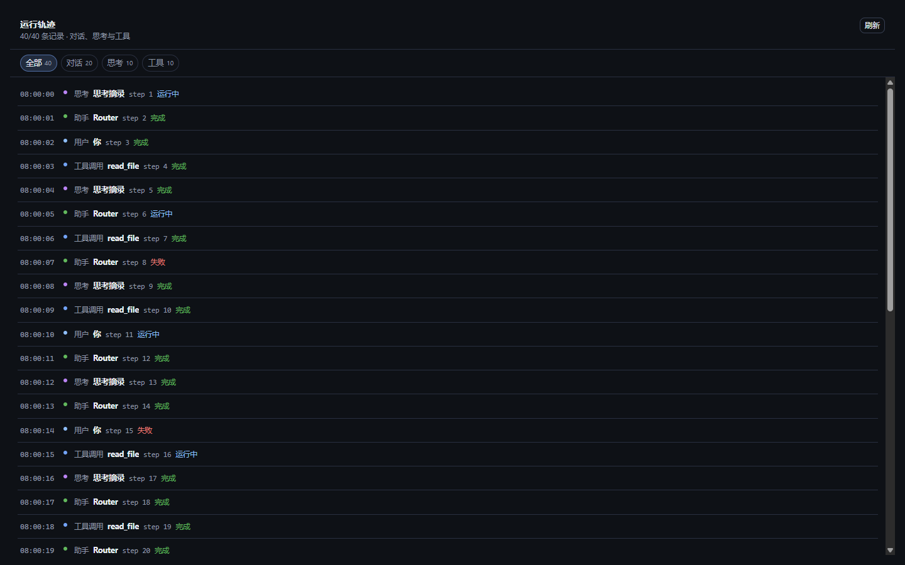
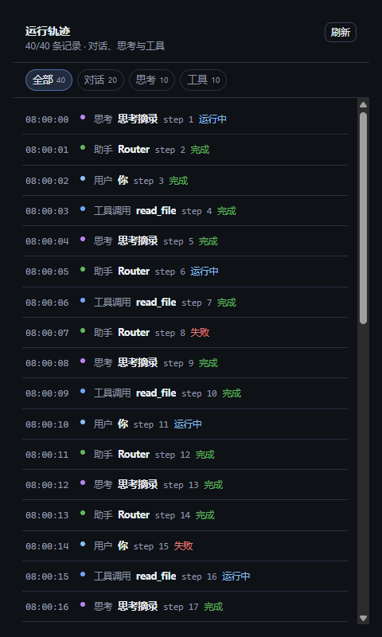

# G15 对话轨迹默认折叠（t462）

## 1. 功能与范围

Chat「轨迹」Tab 的每条记录改为可折叠：summary 行始终显示时间/类型/标题/step/状态，detail 默认隐藏；点击 summary 或原生键盘 Enter/Space 展开/收起，`aria-expanded`/`aria-controls` 同步。默认全部折叠，包括 running 中的工具/记录。

- 分支：`feature/t462-chat-trajectory-collapse`（基于 main `582a77e`）。
- 仅 `src/App.tsx` 的 `ChatTrajectoryPanel` + `src/styles.css` + 测试/docs；无数据源/IPC/权限/依赖变更。
- 过滤（全部/对话/思考/工具）与刷新保持；展开状态按 entry id 保持，切过滤后回来仍展开；新的 entry 默认折叠。

## 2. 实现

- 将原 `<li>` 中恒显示的 `<pre>{detail}</pre>` 改为：
  - 原生 `<button type="button" className="chat-trajectory-summary" aria-expanded={open} aria-controls={detailId}>`，包含完整 summary（time、kind、title、step、status）。
  - `
`，内部 `<pre>`；默认 `hidden`。
- 展开状态 `Set<entry.id>` 保存在 `ChatTrajectoryPanel`：
  - 点击 summary 切换；原生 button 提供 Enter/Space + focus-visible。
  - 过滤不重置 Set；过滤后重新出现仍保持展开。
  - 长 detail 仍截断 6000 字符（`slice(0,6000)+…`）。
  - 展开不触发现有 scroll-to-bottom effect（依赖仅 `entries.length/filter`），保留当前 scrollTop。
- CSS：summary 使用原时间/圆点/body 三列 grid；`.chat-trajectory-detail` padding 对齐，`hidden` display:none；focus-visible outline；不改变 480/960/1440 结构。

## 3. 测试与真实渲染证据

### 3.1 单测 `src/shell/chatTrajectoryCollapse.test.tsx`

- 默认全部 `aria-expanded=false`，detail `hidden=true`，summary 含标题/step/status。
- 点击展开/收起，aria-expanded 与 hidden 同步。
- 过滤“思考”再回“全部”，展开状态保持；同 id refresh/update 后保持。
- 长 detail 展开后 6001 字符（6000+…）。
- aria-controls 指向 detail id；detail role=region。

### 3.2 真实 Chromium 组件夹具

ChatTrajectoryPanel 使用生产组件与 `src/styles.css` 在真实 Electron/Chromium 中渲染（独立组件夹具，不是完整 App Dock；已在 `t462-walkthrough.json` 的 `mode` 字段披露），40 条记录含 running/error/长 detail。

| 1440 默认全折叠 | 960 展开一条 | 480 展开/滚动 |
|---|---|---|
|  |  |  |

`t462-walkthrough.json` 8/8 PASS：

- 1440 默认 40 行、expanded 0、hidden 40、首行 summary 同时含“运行中/step”。
- 点击展开 aria true + detail 可见。
- 真实键盘 `Input.dispatchKeyEvent` Enter 展开第二条，aria 数组 `["true","true","false"]`。
- 过滤“工具”再回“全部”后前两条仍展开。
- 展开 summary 前后 `.chat-trajectory-scroll` scrollTop=160 保持。
- 长 detail 展开文本 6001 字符（截断）。
- 960/480 `scrollWidth === innerWidth`（960/480），无横向溢出；40 行滚动容器正常。

## 4. 验证

- `pnpm typecheck` exit 0。
- `pnpm build` exit 0（js 342.54 kB/gzip 102.24；vendor 414.89/gzip 97.22）。
- `pnpm test -- --max-workers=1 --testTimeout=20000`：157 文件 / 1041 用例全绿（exit 0）。

## 5. 风险与回滚

- 只改轨迹展示层，不影响 chat send/list/turns、过滤/刷新、数据源或权限。
- 展开状态仅会话内存；刷新后回到默认折叠（符合默认折叠要求）。
- 回滚：revert 本 PR 单 commit 恢复恒显详情与旧 CSS。

