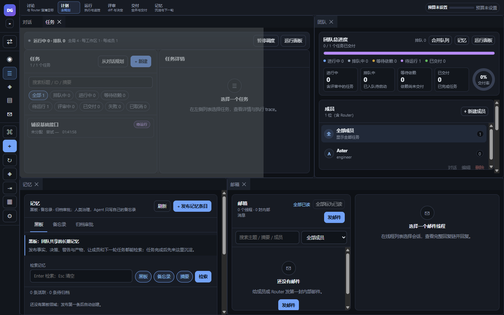
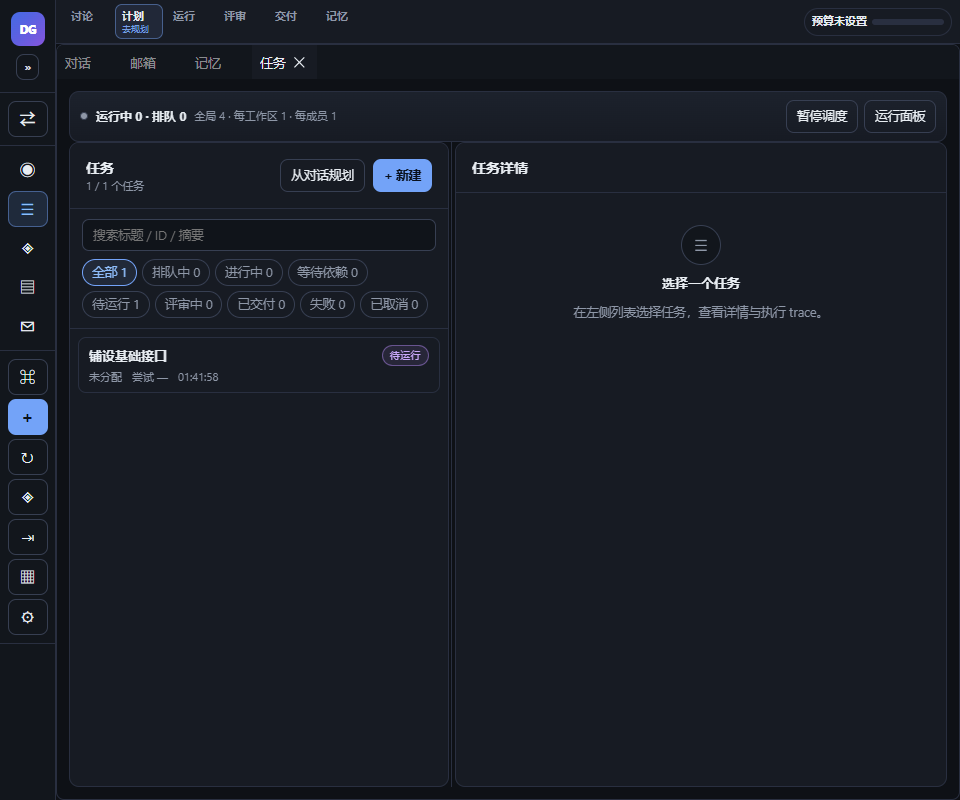
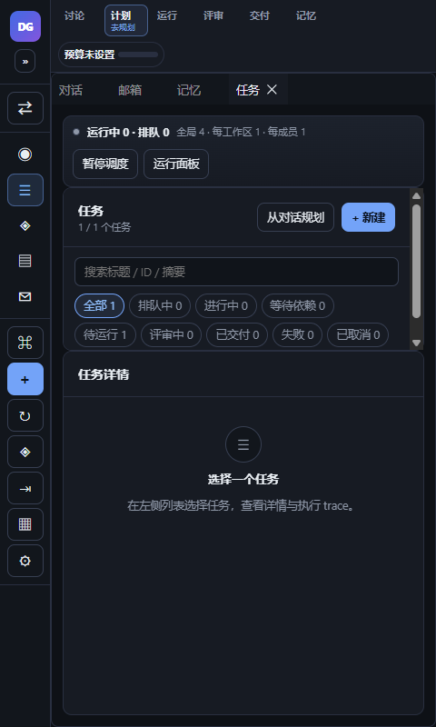

# DW1 回滚：恢复 dockview + 旧 DockShell（t584）

## 1. 用户反馈与决策

新 DockTree 布局交互整体退步（只能左右、不能上下、拖拽/落点不稳）。用户明确要求恢复旧版交互，而不是继续修新系统。本 PR **回滚 DW1-1/2/3/4**，恢复 dockview 8.9.0 + 旧 `DockShell`；保留 O1 / RC1 / MF1 / G2 / D1 / G11 / G12 / G14 等非 Dock 功能。

## 2. Revert 链与冲突处理

按逆序 revert 合并提交（`-m 1`）：

1. `0bb59c7` DW1-4（移除 dockview）
2. `84b0f55` DW1-3（DockTree v2）
3. `2eaa789` DW1-2（reducer/controller shadow）
4. `c9f81c8` DW1-1（layout model）

冲突只在 `src/shell/dock/panelRegistry.ts` 头部：保留 MF1 的 `PANEL_MANIFEST_INDEX` 派生 PANEL_DEFS，同时恢复 v1 `DockStore`/`LAYOUT_KEYS` import 与 v1 API；无业务/gate/权限/数据冲突。v2 文件和测试随 DW1 revert 删除；DockShellV2/Tree/Group/Sash/DropZone 删除。

## 3. 恢复内容

- `package.json` / `pnpm-lock.yaml`：恢复 `dockview-core@8.9.0`、`dockview-react@8.9.0`。
- `src/shell/dock/DockShell.tsx`：恢复 dockview `DockviewReact` 旧容器、tab/sash/拖放/关闭、v1 `loadStore/saveStore`；保留 DockHandle 契约与 App import 不变。
- `src/shell/dock/panelRegistry.ts`：恢复 `deer.dock.state` v1 `DockStore`、`deer.dock.v1.<workspaceId>` 读写；MF1 panel manifest 派生保留。
- `src/shared/layoutPersistence.ts`：恢复 `LAYOUT_KEYS.dockPrefix = "deer.dock.v1."`。
- `src/styles.css`：恢复 legacy `.dock-shell/.dock-root` 与 dockview 主题 CSS。
- v2 `deer.dock.layout.v2` 不再读写（旧 key 可留作备份，不迁移）；v1 key 存在则立即恢复。
- RC1 Compiler：全 renderer 配置保留；已删除文件从高风险列表移除，旧 `DockShell` 加入 `"use no memo"`（旧布局交互高风险）。

## 4. 旧交互验证（真实 Electron/CDP）

工作区 fixture（临时 userData，真实 deer.db）加载真实 `dist`；1440×900。

### 4.1 四向 split 与 sash

- 从旧 DockShell 初始双组开始，真实鼠标拖拽 tab：
  - 任务 tab → 主组底部：创建上下 split；
  - 邮箱 tab → 主组右侧：创建左右 split；
  - 得到 3 组，两个方向同时存在（截图 `t584-dock-fourway-1440.png`）。
- dockview 原生 drop zones 覆盖 center/left/right/above/below；本次真实拖拽覆盖 bottom/right，另由旧 dockview 原生交互提供 left/top/center。
- Sash 真实拖动：
  - 垂直 sash：底部组宽 592/592 → **640/544**；
  - 水平 sash：上/下高度 428/428 → **464/392**；
  - 松手后保持，布局写入 v1 store。
- Screenshot `t584-dockview-1440.png` 为回滚初始布局；`t584-dock-1440.png` 为持久化后布局。

### 4.2 关闭/激活/打开/深链/快捷键/重置

| 操作 | 观察 |
|---|---|
| 点击 task tab / Active | `任务` aria-selected |
| 关闭活动 tab | tabs 6→5，groups 5→4 |
| `#/tasks` 重新打开 | tabs→6，groups 4，active 任务 |
| deep link `#/tasks` | hash `#/tasks`，active 任务 |
| Alt+2 | hash `#/tasks`，active 任务 |
| 关闭全部面板 → watermark | 显示 `恢复默认布局` |
| 点击恢复默认布局 | groups→2，tabs→5，active 对话/团队 |
| Page.reload | v1 store 恢复布局；v1 key 存在，v2 key 不存在 |

证据：`t584-dock-walkthrough.json`。

### 4.3 三档截图/无横向

| 1440 | 960 | 480 |
|---|---|---|
|  |  |  |

- 1440：真实四组/窗口 1440，`scrollWidth===innerWidth`；
- 960/480：dockview 断点切单组，`scrollWidth===innerWidth`，无横向裁切；
- 初始对照：`t584-dockview-1440.png`；四向：`t584-dock-fourway-1440.png`。

## 5. 非 Dock 功能保持

- 默认 build：**934 ms**；index **371.20 kB / gzip 110.42**，vendor-dockview 414.89/97.22，CSS150.01/25.44。
- `pnpm test -- --max-workers=1 --testTimeout=20000`：**179 文件 / 1164 用例全绿**（277.74s）。
- RC1 Compiler：`pnpm build:compiler` 仍成功（index419.91/132.93）；boundary 测试随旧 DockShell 更新并通过（App/DockShell/LazyPanel/PanelHost no-memo，kernel/electron 排除）。
- MF1 panel manifest 测试、O1 关系读路径测试、G2/D1/G11/G12/G14 全量测试均通过；无 kernel/memory/review/watchdog/electron 改动。

## 6. 风险与回滚

- v2 key 不再读写，旧 v1 key 保留；回滚后首次加载即恢复 v1 布局，不迁移/不删除 v2 备份。
- dockview 依赖恢复会增加 bundle（+414.89 kB vendor-dockview JS/136.04 kB CSS），这是恢复旧交互的已知成本。
- 如需再次移除 dockview，按 DW1 后续独立任务处理；本 PR 不重新推进新 Dock。
- 无 schema/DB/权限/gate/IPC 变更；无手工 memo 删除。

