# F1 界面字号三档（t364 / t491 repair-round-2）

## 1. 功能与字号口径

Settings「界面」新增 **小 / 标准 / 大** 三档，默认标准；用 CSS `--font-scale` 等比缩放核心 UI 文本。

| 档位 | factor | 正文/控件 | 小字/状态 | 聊天/Markdown | 代码/思考/翻译 pre |
|---|---:|---:|---:|---:|---:|
| 小 | 0.92 | 12px | 10px | 13px | 13px |
| 标准（默认） | 1 | 13px | 11px | 14px | 14px |
| 大 | 1.15 | 15px | 13px | 16px | 16px |

- 标准档明确为 **正文 13 / 聊天·代码 14**；控件 `12.5 * scale`。
- 小/大按同一 factor 计算，显示值四舍五入；CSS 实际值是 `calc(<基准px> * var(--font-scale))`。

## 2. 实现与覆盖

- `src/shared/types.ts`：`FontScale`、`FONT_SCALE_OPTIONS`（含 body/small/chat/code px）、`normalizeFontScale`/`fontScaleFactor`；`LayoutSettings.fontScale?` 默认 standard，非法值 clamp。
- `src/SettingsView.tsx`：原生 `fieldset` + `role=radiogroup` radio（`aria-label="界面字号：小/标准/大"`），三档 px 与字号预览；fontScale 进入 dirty/fingerprint，保存 payload 携带，成功后更新 baseline。
- `src/App.tsx`：snapshot 恢复、保存后立即 set、`.app` 注入 `--font-scale`/`data-font-scale`，并同步 `document.documentElement` 覆盖 Settings portal。
- `src/styles.css`：
  - `--font-base-size: 13px*scale`、`--font-chat-size: 14px*scale`、`--font-code-size: 14px*scale`、`--font-small-size: 11px*scale`、`--font-control-size: 12.5px*scale`。
  - `.chat-bubble`/`.chat-content`/`.markdown-body` 及 Markdown 的 **p/li/ul/ol/blockquote/标题/table/code/pre** 纳入变量；
  - `.chat-turn-reasoning pre`、`.chat-turn-live pre`、`.chat-turn-translation pre` 使用 **code** 变量；reasoning/translation label/status 使用 small；
  - Task `.tasks-layout/.task-row/.task-detail-panel`，Mailbox `.mailbox-layout/.mailbox-thread-row/.mailbox-thread-body/.message-row` 使用 base；
  - 控件（button/input/select/textarea/label）使用 control 变量；`.tiny` 使用 small 变量。

### 2.1 明确未/不完全缩放范围

本实现不是“全 UI 每个像素文本都等比”，以下保持既有硬编码或本身不是正文：

- 图标 glyph、SVG 图形/图表坐标轴、平台原生控件内部文字；
- 少量高密度 **10–12.5px 微标签/状态 chip/角标**（仍按既有 token/全局 floor 显示），未逐个改写为变量；
- 邮件/任务的个别表格/等高密度元数据保留既有固定值；Chat/Task/Mailbox 的主要正文、列表、代码/thinking/翻译已纳入变量。
- 颜色/对比度、动画/`prefers-reduced-motion` 未改。

## 3. 真实 Electron 证据

环境：真实 Electron（`dist` 构建，隔离 userData），Chat/Task/Mailbox 来自实际 App 路由；Chat 在 fixture 的 Dock overlay 默认 hidden，截图时仅将既有 `.dv-render-overlay` 设为 visible（不改 Chat/Markdown DOM/字号），walkthrough `mode` 字段已披露。Task/Mailbox 走 `#/tasks`、`#/mailbox` 实际路由。

### 3.1 Chat / Task / Mailbox 3×3

| Chat | 1440 | 960 | 480 |
|---|---|---|---|
| 小 |  |  | 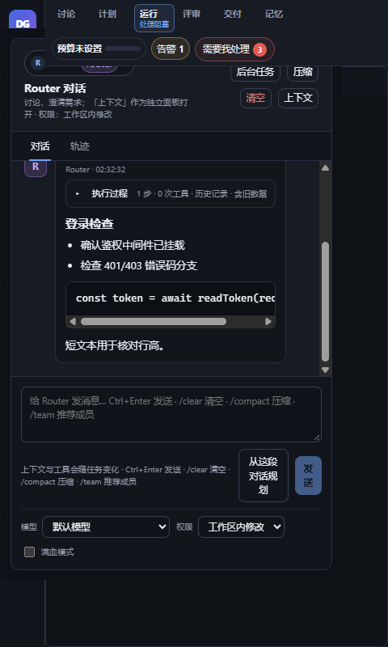 |
| 标准 | 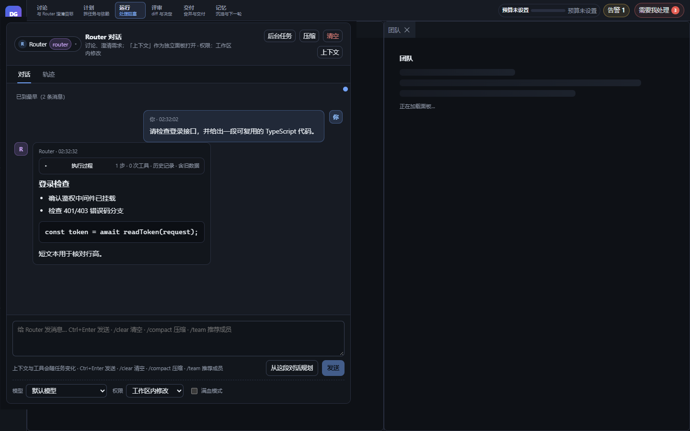 |  |  |
| 大 |  | 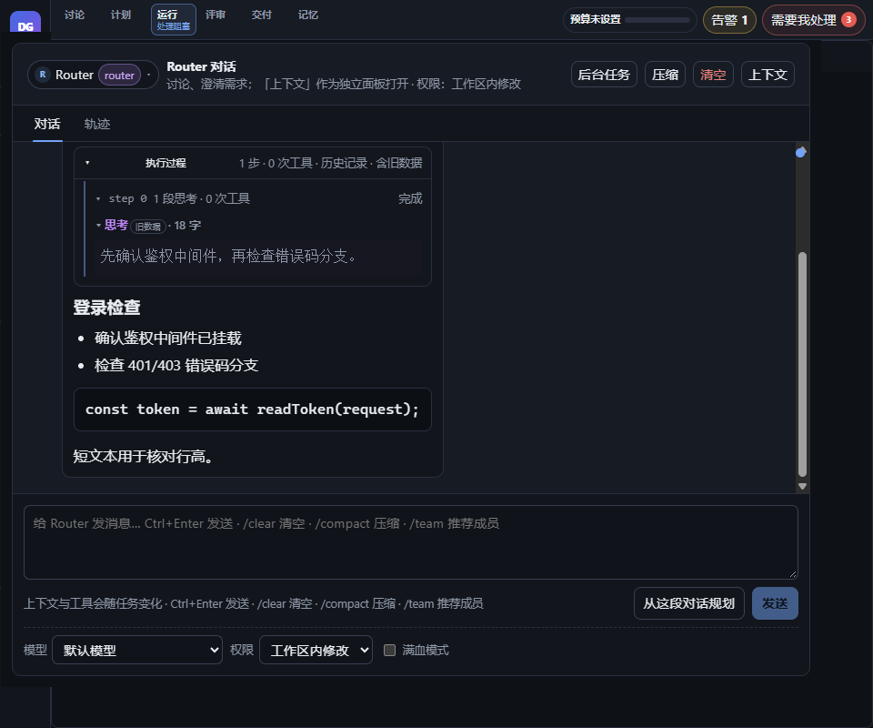 |  |

| Task | 1440 | 960 | 480 |
|---|---|---|---|
| 小 |  |  |  |
| 标准 |  | 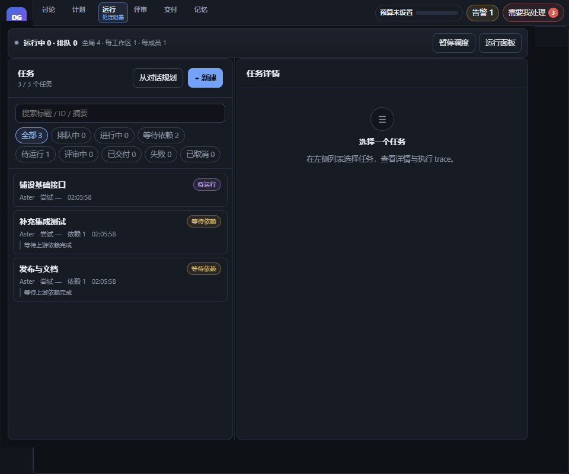 |  |
| 大 |  |  | 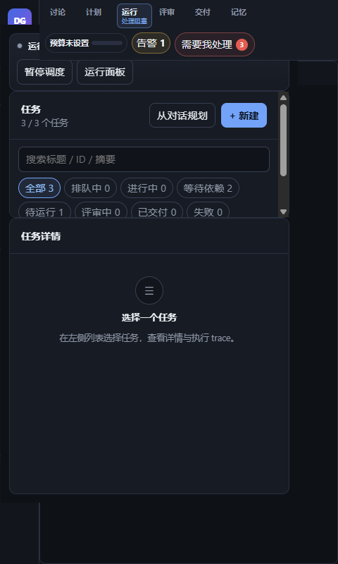 |

| Mailbox | 1440 | 960 | 480 |
|---|---|---|---|
| 小 | 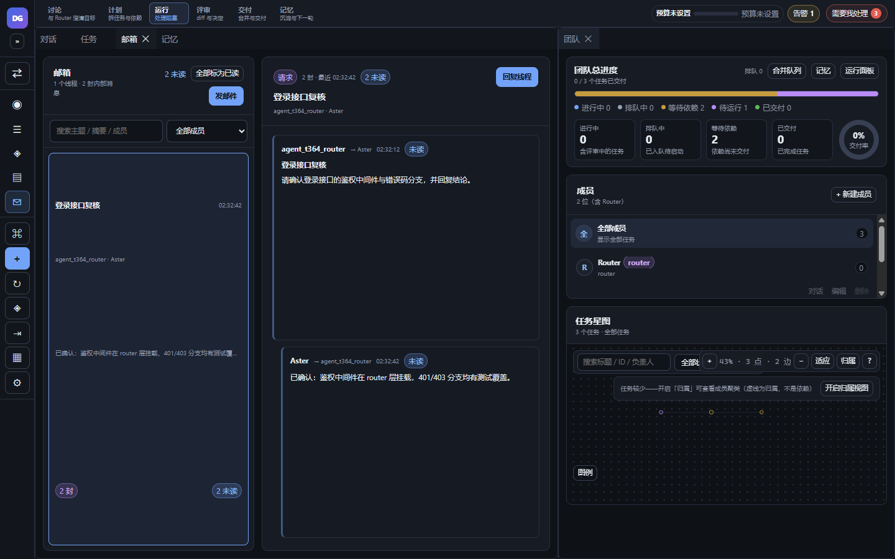 | 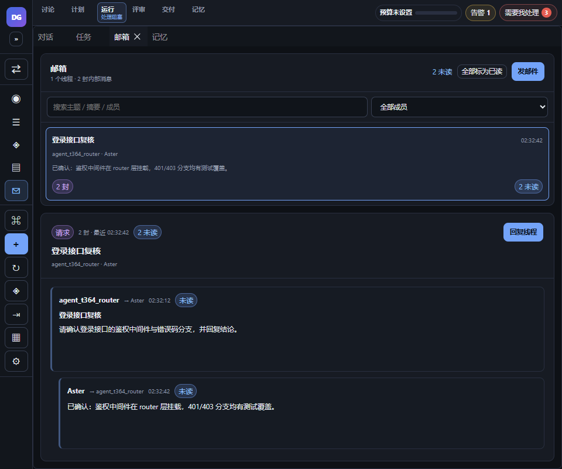 |  |
| 标准 |  | 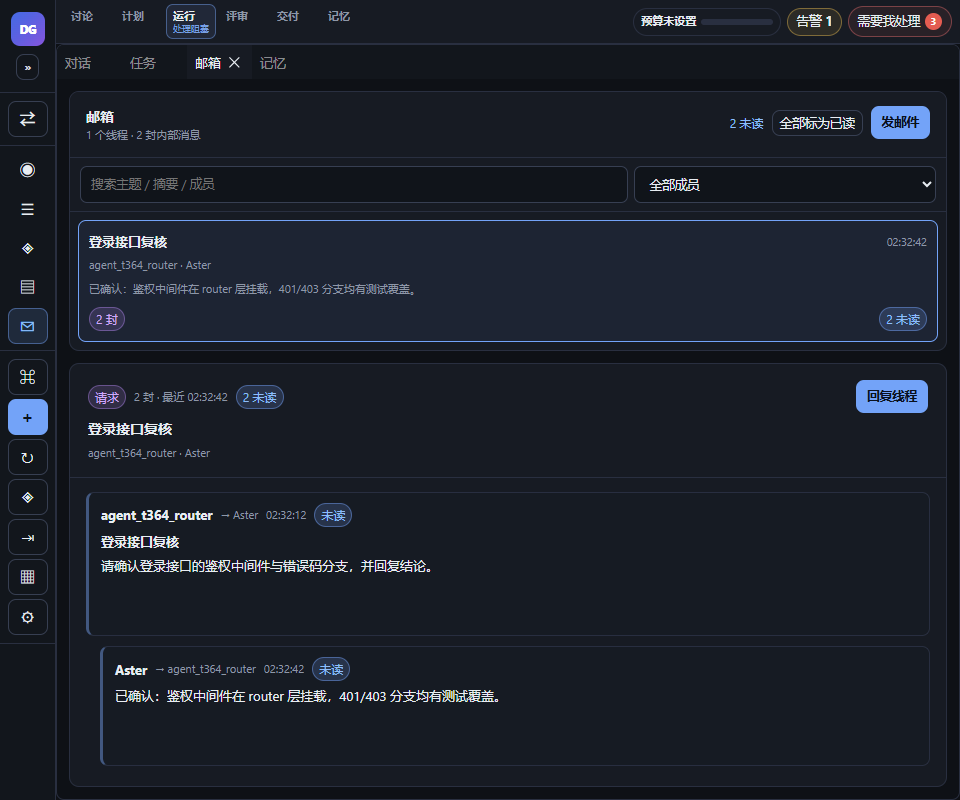 |  |
| 大 |  | 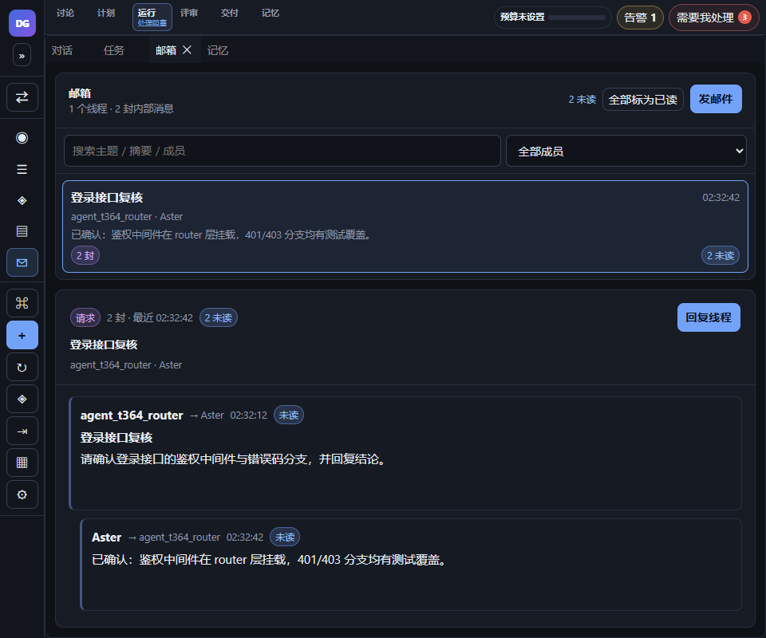 | 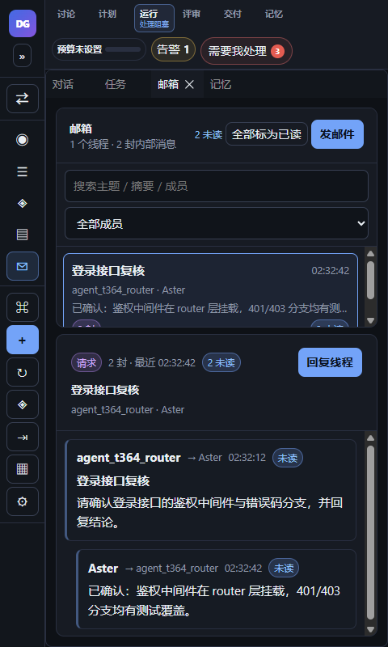 |

- `t364-font-panels-walkthrough.json`：27/27 断言通过；每档/每宽度记录 `scrollWidth===innerWidth`、layout rect>0、实际 computed font：
  - Chat bubble/markdown/code：`12.88/14/16.1px`；
  - Task row：`11.96/13/14.95px`；
  - Mailbox thread body：`11.96/13/14.95px`。
- 三档 480 均无根级横向裁切；Task/Mailbox 内部滚动保持可用。Mailbox 480 内部 layout 仍有 878px（既有 mailbox 双列内部宽度），根级 `scrollWidth` 480、截图无页面横向裁切；该内部宽度为既有布局行为，不在本 PR 重排。
- 代码/thinking 专项：`t364-font-chat-code-thinking.json` + `t364-chat-thinking-standard-1440.png`；Chat Markdown fenced code 与 reasoning pre 均 14px/1.65 标准；reasoning 展开可见。
- 翻译 pre 的真实 Chat 需要启用翻译 provider/网络，本 fixture 未产生 `.chat-turn-translation pre`；翻译字号由 Settings 预览的同一 `--font-small-size` 记录（10.12/11/12.65px），未虚报真实 Chat 翻译已触发。

### 3.2 Settings 3×3

| 档位 | 1440 | 960 | 480 |
|---|---|---|---|
| 小 | 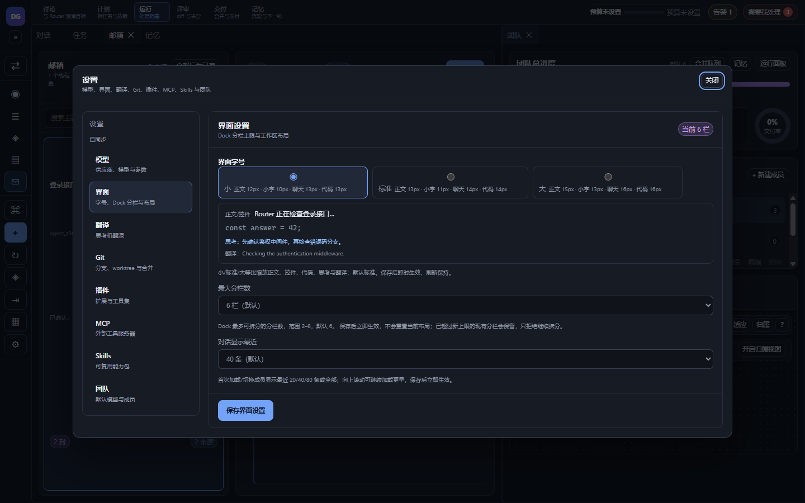 |  |  |
| 标准 |  | 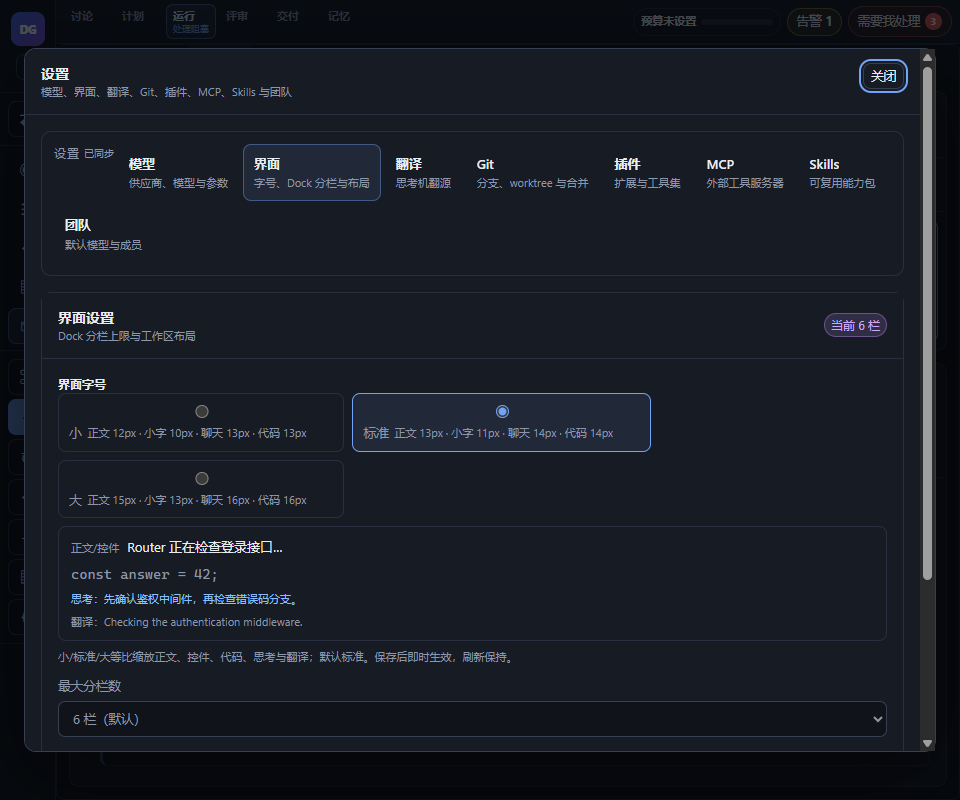 |  |
| 大 | 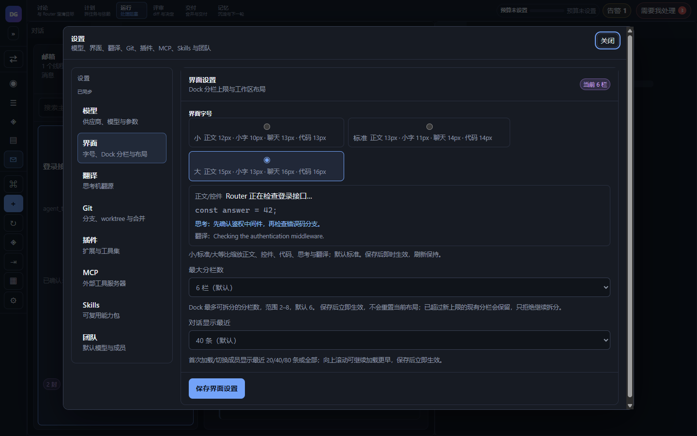 | 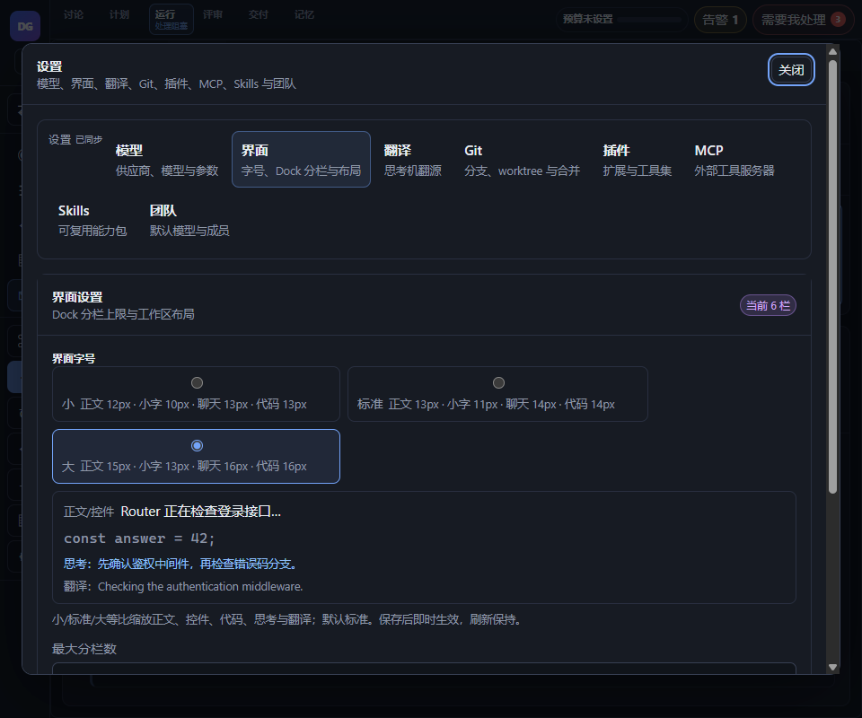 |  |

`t364-font-settings-walkthrough.json` 9/9：body 11.96/13/14.95、preview 11.96/13/14.95、code 12.88/14/16.1、thinking/translation 10.12/11/12.65；480 modal 宽 432（x24/right456），无横向。

## 4. 键盘 / dirty / 持久化 / 对比度 / 行高

- `t364-font-radio-keyboard.json`：焦点在“标准”后按 ArrowRight，焦点/选中变为“大”；`t364-font-radio-keyboard-1440.png` 有可见 focus ring。原生 radio 组共 3 个。
- `t364-font-save-refresh.json`：large→small 保存后即时 `--font-scale=0.92`、body 11.96px、small checked；Page.reload 后保持。dirty guard/payload 由 `src/shell/fontScaleSettings.test.tsx` 覆盖；非法值 clamp 由 `src/shared/fontScale.test.ts` 覆盖。
- 对比度：颜色 token 未改，计算值 `t364-font-contrast.json`：正文 `#e6edf3` on `#0d1117` = **16.02**、on panel = **14.64**；muted = **6.45/5.90**；状态绿/黄/红/紫/蓝 = 7.45/7.50/5.65/7.51/7.49（vs bg）。均与字号大小无关。
- 行高：Chat content 23.1px/14 = **1.65**；Markdown 23.8/14 = **1.7**；reasoning pre 23.1/14 = **1.65**；Task row 19.5/13 = **1.5**；Mailbox thread body 20.8/13 = **1.6**。这些规则未改。
- 动效：未新增 animation/transition；既有 `prefers-reduced-motion` 规则保持。
- 200% 口径：沿用本仓库既有 a11y 基线——真实 Electron **480 CSS 视口**实测；不宣称 OS 200%/DPR2。480 三档截图与 `scrollWidth` 断言已记录；系统级 200% 走查为既有基线约定。

## 5. 验证

- `pnpm typecheck` exit 0。
- `pnpm build` exit 0（index 364.80 kB / gzip 108.71；vendor 414.89 / 97.22）。
- `pnpm test -- --max-workers=1 --testTimeout=20000`：169 文件 / 1110 用例全绿（exit 0）。
- CI 宽限：本仓库既有 plain test 5s timeout flake；本 PR 使用 serial/extended（`--max-workers=1 --testTimeout=20000`）验证，不把既有并行 timeout 归因于本 PR。

## 6. 风险与回滚

- 字号仅 UI scale，不改数据/权限/IPC/schema/依赖；旧 `layout.settings` 缺 fontScale 自动回标准。
- 残余固定微标签已在 §2.1 明示，不宣称所有文本完整等比。
- 回滚：revert 本 PR commit；无迁移。

