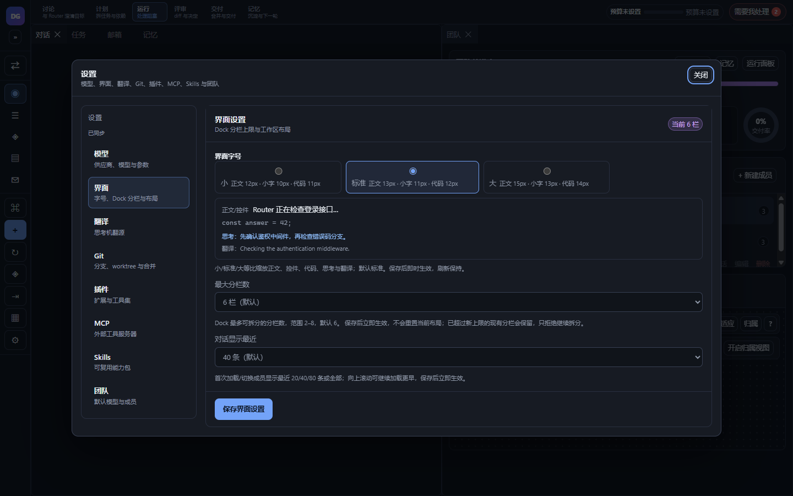
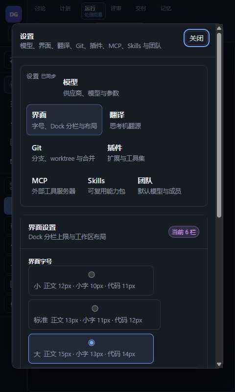

# F1 界面字号三档（t364）

## 1. 功能与范围

Settings「界面」新增字号三档 **小 / 标准 / 大**，驱动正文、控件、代码、思考（reasoning）与翻译字号等比缩放：

| 档位 | factor | 正文字号 | 小字 | 代码/思考/翻译 |
|---|---:|---:|---:|---:|
| 小 | 0.92 | 12px | 10px | 11px |
| 标准（默认） | 1 | 13px | 11px | 12px |
| 大 | 1.15 | 15px | 13px | 14px |

实现不新增依赖、不改权限/数据层；设置沿用既有 `layout.settings` JSON。

## 2. 实现

- `src/shared/types.ts`
  - `FontScale = "small" | "standard" | "large"`、`FONT_SCALE_OPTIONS`（factor + 文档 px）、`DEFAULT_FONT_SCALE = "standard"`、`normalizeFontScale`、`fontScaleFactor`。
  - `LayoutSettings.fontScale?`；`DEFAULT_LAYOUT_SETTINGS` 默认标准；`normalizeLayoutSettings` clamp 非法值到标准。
- `src/SettingsView.tsx`
  - 界面区 radio group（`role=radiogroup`，原生 radio，`aria-label="界面字号：小/标准/大"`）；显示三档 px。
  - `fontScale` 进入 layout baseline/fingerprint，改动触发 dirty guard；保存 payload 带 `layout.fontScale`，成功后更新 baseline/状态。
  - 增加「字号预览」：正文/控件、代码、思考、翻译四行，使用同一 CSS 变量，便于三档视觉核对。
- `src/App.tsx`
  - `uiFontScale` state；snapshot 恢复；保存成功后立即 set（无需等待 refresh）；
  - 根 `.app` 注入 `--font-scale` + `data-font-scale`；同步写 `document.documentElement.style` 以覆盖 portal 的 Settings Modal；
  - `handleSaveSettings` 保存后即时更新字号。
- `src/styles.css`
  - `:root --font-scale` + `--font-base-size/--font-small-size/--font-code-size/--font-control-size`；
  - 正文、`.tiny`、代码/`pre`、thinking/translation、控件、Settings nav/radio 均使用 calc 变量；保留原色 token，无动画改动。
  - Settings Modal 在 480 下 `width:min(1180px,100%)`，不越出 backdrop 24px padding。

## 3. 测试

- `SettingsView.test.tsx`：默认标准 radio；切换 small 置 dirty；保存 payload `layout.fontScale=small` 且成功后清 dirty；非法 `"huge"` 回标准。
- `kernel/layoutSettings.test.ts`：store 默认 standard、持久化 large、非法回 standard。
- 真实 Electron/CDP：
  - `t364-font-save-refresh.json`：large 1.15→选择 small 保存后即时 `--font-scale=0.92`/body 11.96px/radio checked；Page.reload 后仍 0.92 且 small checked。
  - `t364-font-scale-walkthrough.json`：3 档 × 1440/960/480，body/preview/code/thinking 字号分别为 11.96/11.04/10.12、13/12/11、14.95/13.8/12.65；三档 modal 在 480 宽 432（x24/right456），`scrollWidth===innerWidth`，radio checked 正确。

## 4. 三档 × 三档截图

| 档位/宽度 | 1440 | 960 | 480 |
|---|---|---|---|
| 小 |  |  |  |
| 标准 |  |  |  |
| 大 |  |  |  |

- 480 档 Settings modal 宽 432、左右 24px 安全边距；三档均无横向裁切。
- 预览代码/思考/翻译与正文同比例；颜色 token 未改（对比度不变）；未新增动画，`prefers-reduced-motion` 规则不受影响。
- 200% 文本缩放的通用溢出保护：Settings radio 行 flex-wrap、preview `overflow-wrap:anywhere`、modal `width:min(1180px,100%)`；本实现三档在 480 已实测无横向。

## 5. 验证

- `pnpm typecheck` exit 0。
- `pnpm build` exit 0（js 364.77 kB / gzip 108.69；vendor 414.89 / 97.22）。
- `pnpm test -- --max-workers=1 --testTimeout=20000`：167 文件 / 1108 用例全绿（exit 0）。

## 6. 风险与回滚

- 字号仅 UI scale，不改数据/权限/IPC/schema；布局设置沿用现有 JSON，旧值缺失回标准。
- 大字号可能使部分高密度小控件换行；480 已实测无横向，关键 Settings/预览可读。
- 回滚：revert 本 PR 单 commit；旧 `layout.settings` 无 fontScale 自动回标准。

