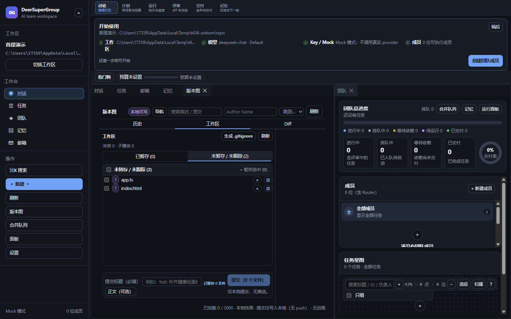
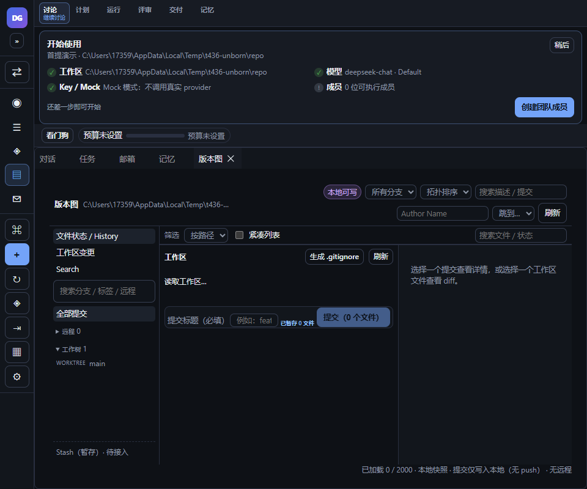
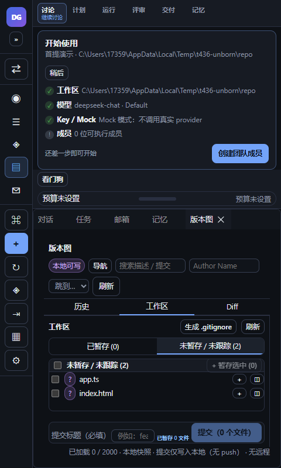

# G10 移除首次提交引导卡（t436）

## 1. 用户要求（优先于旧验收文案）

用户明确要求：**直接删除**「首次提交」引导卡，不是增加关闭按钮/持久化隐藏状态。因此本实现删除卡片本身；`GitGraphPanel` 不再有 `.git-first-commit`、关闭按钮或 hidden/持久化状态。任务 contract 中「有关闭按钮/按 workspace 持久化」为与用户要求冲突的旧文案，已按用户指令以“彻底移除”替代。

## 2. 变更

- `src/git/ui/GitGraphPanel.tsx`：
  - 删除 `WorkingTree` 的 `isFirstCommit` prop 及调用处传递；
  - 删除 `isFirstCommit && canWrite` 的 `.git-first-commit` 整块卡片（标题+三步说明）；
  - 保留工作区实际控件：staged/unstaged 分组、暂存/取消暂存、提交标题/正文、提交按钮、`.gitignore` 生成、刷新、错误提示。
- `src/git/ui/gitGraph.css`：删除 `.git-first-commit` / `.git-first-commit strong` 规则。
- `src/git/ui/GitGraphPanel.test.tsx`：
  - 删除已无效的“repo loading 时闪出首提引导”测试（卡片已不存在）；
  - 原空仓库测试改为「保留工作区控件但无首提卡」：断言 `首次提交` 不出现、`尚无提交` graph 空态仍存在、无暂存提交按钮 disabled；
  - 其它 G1/G9 测试保持。
- 不改变 G1 写通道/IPC/数据、G9 分隔条/短高隐藏。

## 3. 真实 Electron 空仓库走查

真实 Electron + 隔离 `--user-data-dir` + `DSGITWRITE_SEED_KIND=unborn`（未提交空仓库），CDP 三档 viewport + 显式 resize：

| 1440 空仓库工作区 | 960 | 480 |
|---|---|---|
|  |  |  |

`t436-walkthrough.json`：

- 1440/960/480：`.git-first-commit` 节点 **0**、页面不出现「首次提交」、三步说明文案不出现。
- 三档仍存在「生成 .gitignore」「提交（0 个文件）」与 `.git-st-workspace`；空仓库控件可用/禁用语义正常。
- `document.documentElement.scrollWidth === innerWidth`（1440/960/480），无横向溢出。

## 4. 验证

- `pnpm typecheck` exit 0。
- `pnpm build` exit 0（js 334.50 kB / gzip 99.74；GitGraphPanel 47.30 kB；vendor 414.89 / 97.22）。
- `pnpm test -- --max-workers=1 --testTimeout=20000`：144 文件 / 992 用例全绿（exit 0）。

## 5. 风险与回滚

- 只删除冗余引导文案与失效 prop/CSS，不删除任何写操作或快捷键。
- 旧验收中的关闭/持久化不复存在，符合用户“直接删除”要求；没有新增 localStorage/状态。
- 回滚：revert 本 PR 单 commit 即恢复卡片与 `isFirstCommit`；不影响数据/schema。

