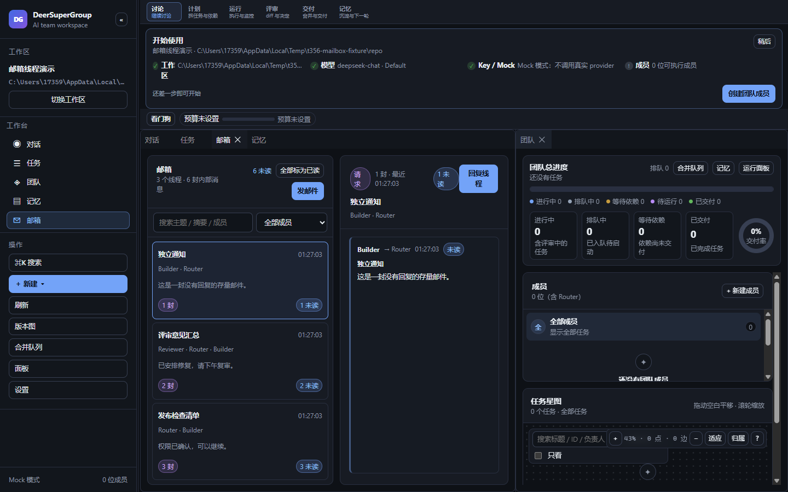
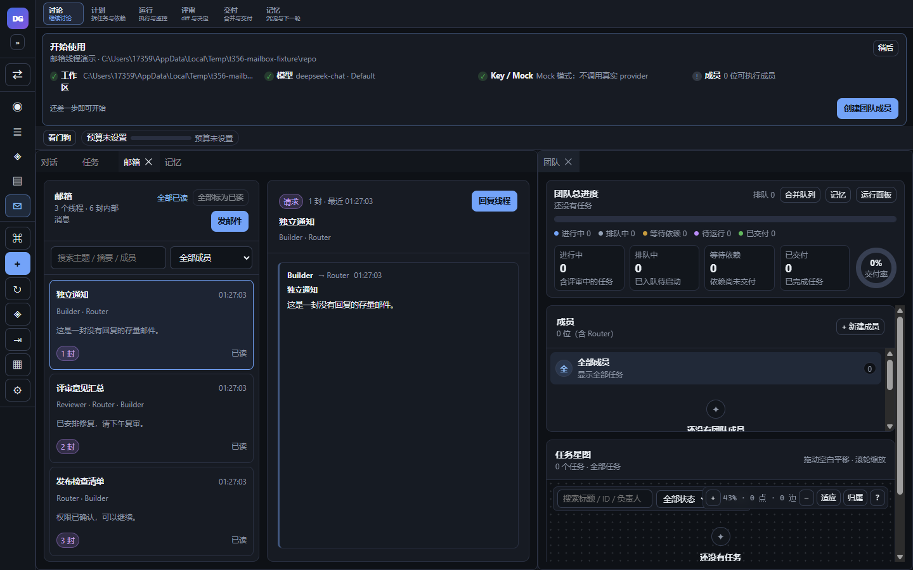
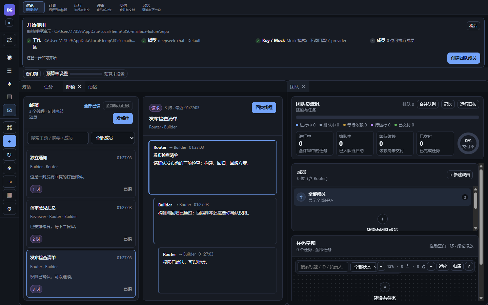
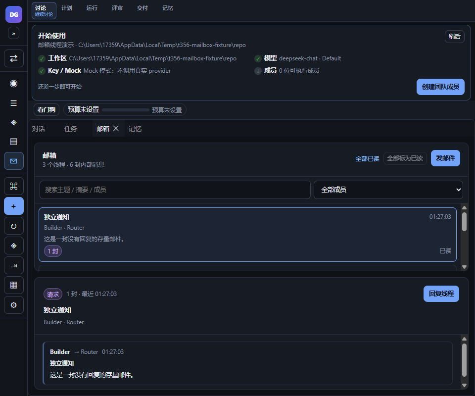
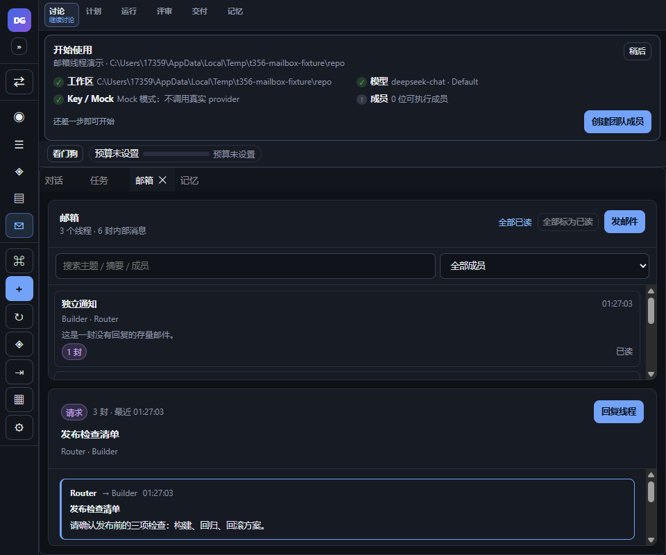
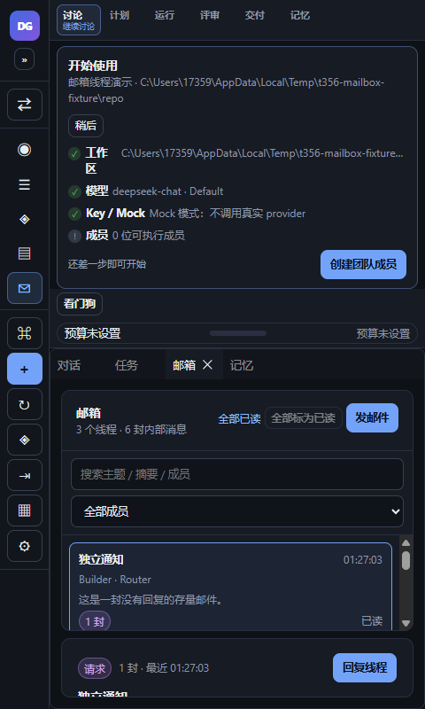
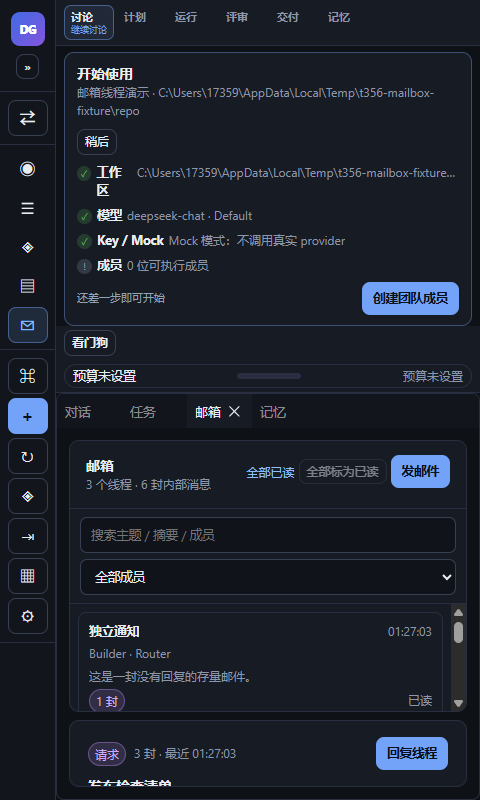
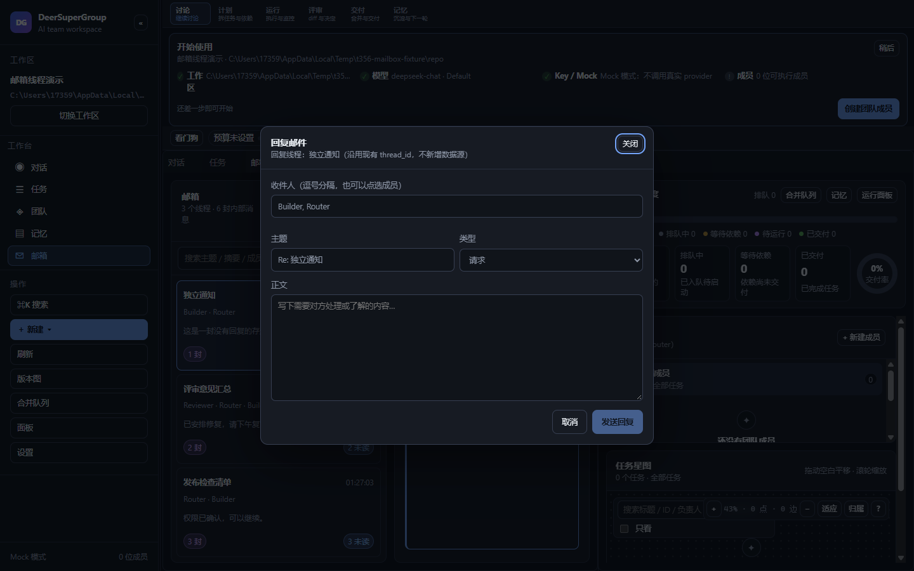
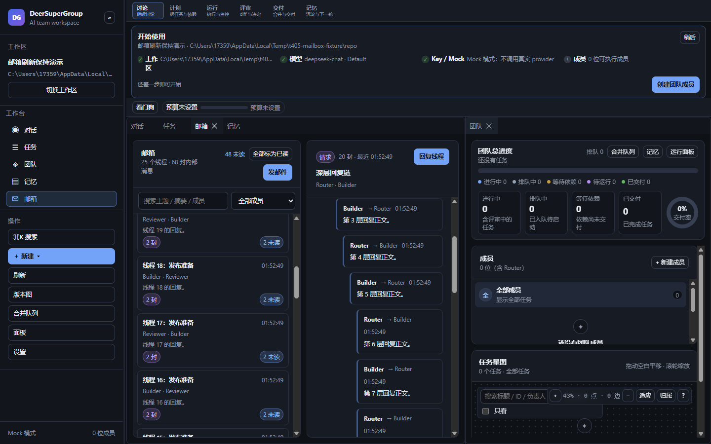

# M1 邮箱线程化（t356）

## 1. 功能与范围

把邮箱从平铺消息改为**线程视图**：同一线程的回复链、未读聚合、全部已读、线程搜索/成员过滤，以及 1440/960/480 三档响应式与键盘/aria。

- 单一功能：邮箱线程化。
- 分支：`feature/t356-mailbox-threads`（PR https://github.com/DeerLuuu/deer-super-group/pull/55，未合并）。
- 基线：main `e2ac41a`（G3 SourceTree Git 面板已合入后的最新 main）。
- 不新增数据源、不改权限、不改 schema；没有新增 IPC 通道。

## 2. 当前数据模型与兼容策略（重要）

仓库当前 `messages` 表只有 `thread_id`，**没有 `parent_id` 列**；现有 `MailboxMessage` 也只有 `threadId`。本任务不迁移 schema，因此：

1. `src/shared/mailboxThreads.ts` 投影同时支持：
   - 消息上的可选 `parentId`（为已有/未来数据保留的链式字段）；
   - 存量 `threadId`：同 `thread_id` 的消息聚合为一线程；
   - 没有 parentId 的存量消息：按各自 `thread_id` 分组；若 thread_id 互不相同则各自成独立线程。
2. 同一线程内，若消息没有显式 `parentId`，按创建时间把**上一封**作为展示父节点，形成线性回复链（根 → 回复 → 再回复），用于缩进/连线。
3. 线程投影的 `threadId` 取**根消息 id**；另保留 `threadKey = 根消息.threadId`。
4. 回复沿用现有 `messages.thread_id`：`SendMessageInput` 增加可选 `threadId`（仅复用现有列，不新增列/通道），Electron 现有 handler 透传，`Store.addMessage` 已有 `threadId` 入参。
5. 存量无 parentId、thread_id 各异的旧邮件不丢、不合并；有同 thread_id 的历史项目仍按原线程聚合。

这是对“现有 parentId 链”在当前 schema 下的兼容实现：行为上线程根/回复链/缩进完整；没有为了本功能增加数据库迁移。

## 3. 线程/未读/搜索

- 线程列表按最近活动（最后消息 `createdAt`）倒序；新消息刷新后自动置顶。
- 行内显示：根主题、参与者、消息数、未读数、最后一条摘要/时间。
- 未读按**线程聚合**；点击线程标记该线程已读；顶部「全部标为已读」一次标记当前全部消息。
- read state 是 UI-only：按工作区写 `localStorage["deer.mailbox.read.<workspaceId>"]`，刷新保持；不新增 DB/数据源。
- 搜索：主题、摘要、参与者、正文；成员下拉按 `from`/`to` 参与者过滤。
- 无邮件 / 搜不到结果分别显示带行动的空态；清除筛选可恢复。
- 当前选中线程高亮；深链 `#/mailbox?m=<messageId>` 会定位到包含该消息的线程（回复链内定位）。
- 点击「回复线程」打开 compose，自动带线程参与者、`Re:` 主题与 `threadId`（`threadKey`），发送后仍停留在该线程。

### 3.1 刷新/重排/新消息保持（t405）

- 线程列表与详情滚动锚点用「第一可见项稳定 id + 相对 offset」表示（不是绝对 scrollTop），实现于 `src/shell/mailboxScroll.ts`；线程 key 使用根消息 id。
- 滚动/刷新/新消息到达/重新挂载后，`MailboxView` 在 layout effect 中恢复线程列表与回复链锚点；锚点按工作区写 `sessionStorage["deer.mailbox.scroll.<workspaceId>"]`（UI-only），返回该 Tab 或刷新页面仍保持。
- 选中线程由 App 的 `selectedMessageId` 保持；新消息使线程按 lastActivity 置顶时，当前线程仍展开（`data-expanded`/`aria-selected`），列表滚动锚点不丢；详情链有新回复时原消息锚点不跳。
- `t405-mailbox-walkthrough.json`：刷新前/后 listTop 620、chainTop 260、firstThread offset 67、active 深层回复链都一致；插入新线程并刷新后 `topSubject=新消息`、rows 25→26、listHeight 2914→3030、firstThread/offset/chainTop 保持，active 仍为深层回复链。
- 截图：`t405-mailbox-1440-scroll-before.png`、`-after-refresh.png`、`-after-new.png`。

### 3.2 深度/缩进上限（t405 F2）

- `MAILBOX_MAX_DEPTH = 12`：投影 depth 最大 12，防止无限递归/极端缩进。
- `MAILBOX_MAX_INDENT = 6`：UI 最大缩进 `6 × 14px = 84px`，更深回复仍展示内容但不继续右移。
- `mailboxThreads.test.ts` 的 50 层父链测试确认 `depth[0]=0`、`depth[12]=12`、`depth[49]=12`。

## 4. 组件与文件

- `src/shared/mailboxThreads.ts`：纯投影 `deriveMailboxThreads`、`filterMailboxThreads`、`mailboxParticipants`、`totalMailboxUnread`、depth/indent 上限、read-state 存取。
- `src/shared/mailboxThreads.test.ts`：8 项纯函数测试（含 50 层深链、read-state reload）。
- `src/shell/mailboxScroll.ts`：滚动锚点捕获/恢复/序列化纯函数。
- `src/shell/mailboxScroll.test.ts`：5 项测试（重排、新消息顶部插入、详情、持久化容错）。
- `src/App.tsx`：`MailboxView` 线程列表 + 回复链 + 搜索/过滤 + 全部已读 + scroll 保持 + compose 线程上下文；App read state/localStorage；`MailboxComposeModal` 可选 thread 预填。
- `src/shared/types.ts`：`MailboxMessage.parentId?`、`SendMessageInput.threadId?`（均为可选，不改 DB）。
- `src/styles.css`：线程列表/链/未读/过滤条；≤900/≤720/≤480 单列布局，无横向溢出。
- `src/shell/MailboxView.test.tsx`：6 项视图测试（含新消息置顶保持展开）。
- `src/shell/mailboxAppThread.test.tsx`：1 项 App 级 Command Palette → mailbox 线程定位测试。
- `src/shell/MailboxComposeModal.test.tsx`：原失败保留测试保持通过。

## 5. 截图与真实 Electron 走查

真实 Electron（隔离 `--user-data-dir` + 临时 fixture DB；fixture 6 封邮件、3 个线程），CDP `Emulation.setDeviceMetricsOverride` + 显式 `resize`：

| 1440 线程列表（未读 6） | 1440 已全读 | 1440 三封回复链 |
|---|---|---|
|  |  |  |

| 960 线程列表 | 960 三封回复链 | 480 线程列表 | 480 三封回复链 |
|---|---|---|---|
|  |  |  |  |

1440 回复 compose（`Re: 独立通知`，收件人来自线程参与者）：

t405 刷新/重排保持截图（25 个线程，list/detail 均滚动到中段）：

| 刷新前（listTop 620 / chainTop 260） | 刷新后（锚点/展开保持） | 新消息置顶后（锚点/展开保持） |
|---|---|---|
|  |  |  |

`t405-mailbox-walkthrough.json` 记录：before/after-refresh listTop 620、chainTop 260、firstThread offset 67、active 深层回复链完全一致；插入新线程并刷新后 topSubject=新消息、rows 25→26、firstThread/offset/chainTop 保持；`全部标为已读` settled 后未读为 `全部已读`（修正旧 walkthrough 采样时机）。

`t356-mailbox-walkthrough.json` 记录 DOM 断言：

- 3 个线程；同 thread_id 的 3 封显示 1 行、3 封 / 3 未读；点击后回复链 3 条，缩进 `0/14/28px`。
- 「全部标为已读」后 `全部已读`；搜索「评审」后 1 行；成员过滤 `Reviewer` 后 1 行；无结果空态。
- 回复弹窗主题 `Re: 独立通知`、收件人 `Builder, Router`；发送回调携带 `threadId`。
- 焦点首行 + `ArrowDown` 后 `aria-selected` 移到第二线程；列表 `role=listbox`、行 `role=option`、`aria-label` 含线程/未读数。
- 960/480 `documentElement.scrollWidth === innerWidth`（960/480），无横向裁切。

## 6. 验证

- `pnpm typecheck` exit 0。
- `pnpm build` exit 0（js 323.86 kB / gzip 96.57；vendor 414.89 / 97.22）。
- `pnpm test -- --max-workers=1 --testTimeout=20000`：129 文件 / 915 用例全绿（exit 0）。默认并行 5s timeout 与串行首轮 openai 5s timeout 均为既有重测试基线（与本功能无关；扩展/串行重跑通过）。

## 7. 风险、边界与回滚

- 未改 `src/kernel/`、`electron/`、`src/git/`、权限、数据源、IPC 通道；只复用现有 `thread_id` 列和现有 `sendMessage`。
- read state 仅在工作区 localStorage；scroll 锚点仅在工作区 sessionStorage（UI-only，不跨设备/不写 DB）；换工作区按 key 隔离。
- 当前没有真实 `parent_id` 列，显式 parentId 分支主要服务已有/后续数据；存量兼容路径已验证。
- 回滚：revert 本 PR 单 commit；不影响已有消息与 schema。

