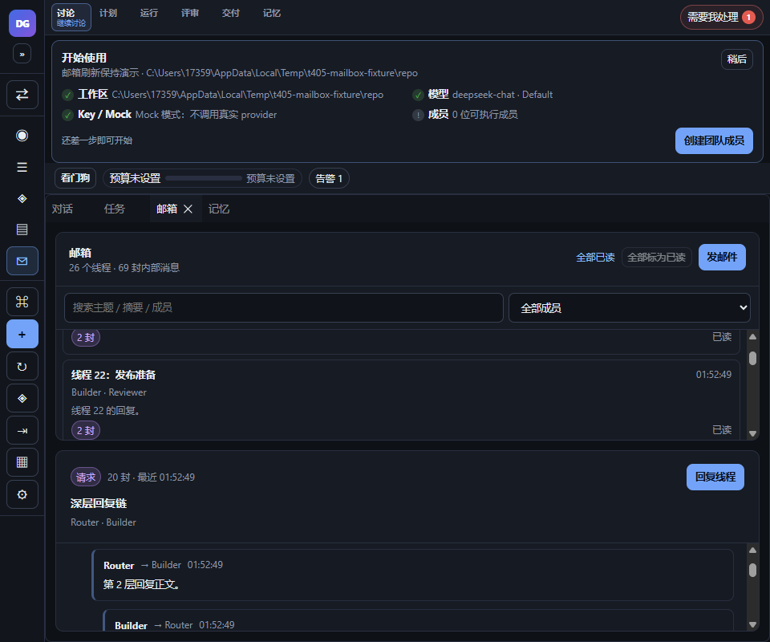
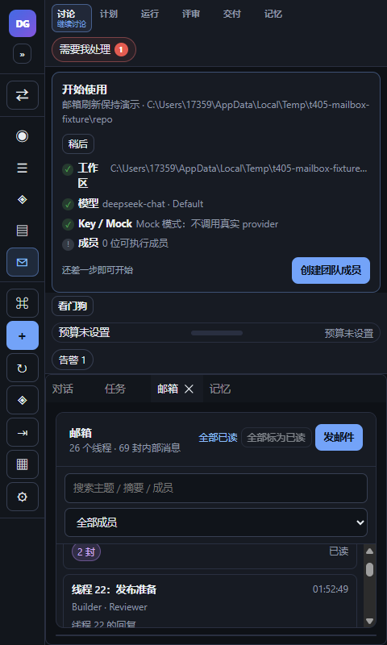

# M1 邮箱线程化（t356）

## 1. 功能与范围

把邮箱从平铺消息改为**线程视图**：同一线程的回复链、未读聚合、全部已读、线程搜索/成员过滤，以及 1440/960/480 三档响应式与键盘/aria。

- 单一功能：邮箱线程化。
- 分支：`feature/t356-mailbox-threads`（PR https://github.com/DeerLuuu/deer-super-group/pull/55，未合并）。
- 基线：main `e2ac41a`（G3 SourceTree Git 面板已合入后的最新 main）。
- 不新增数据源/IPC/权限；新增 `messages.parent_id` 可空列迁移（旧行保持 NULL），回复真实落库。

## 2. 数据模型与回复链（真实 parent_id）

1. `messages` 表新增 **可空 `parent_id`**（`node:sqlite` `ALTER TABLE ADD COLUMN` 幂等；新库直接建列）；旧库启动时补列，旧行 `parent_id` 保持 NULL，不强行回填。
2. `MailboxMessage.parentId?: Id` 由 `toMessage` 从 `parent_id` 读回；`SendMessageInput.parentId?: Id` 由 App/Compose 传入；`Store.addMessage` 写入 `parent_id`；顶层消息为 NULL。
3. 回复 compose 传**被回复消息 id**（当前选中消息；无选中时用线程最后一条），并带线程 `threadId` 存储键；顶部「发邮件」不带 parentId。
4. `deriveMailboxThreads` 优先真实 `parentId` 建链，支持 A→B、A→C 分支；只有**整条 thread 都没有 parentId 的 legacy 数据**才保留 thread_id + createdAt 线性兼容，不再对新数据按 createdAt 推断父节点。
5. 线程 `threadId` 取根消息 id，`threadKey` 保留 DB `thread_id`；同一 thread_id 仍聚合，真实 parentId 跨 thread 时也会 union 到同一线程。
6. 真实 DB 测试：`Store.addMessage`→`listMessages`→`toMessage` 读回 parent_id、A→B/A→C 分支投影、旧库补列幂等、旧行 NULL 兼容；迁移在启动期完成，失败关闭连接并拒绝启动，不留下半迁移状态。另有真实 Electron UI 回复→SQLite 查询证据（`t409-mailbox-parent-roundtrip.json`）：parent_id 指向被回复消息，thread_id 保持 `thread-deep`。

## 3. 线程/未读/搜索

- 线程列表按最近活动（最后消息 `createdAt`）倒序；新消息刷新后自动置顶。
- 行内显示：根主题、参与者、消息数、未读数、最后一条摘要/时间。
- 未读按**线程聚合**；点击线程标记该线程已读；顶部「全部标为已读」一次标记当前全部消息。
- read state 是 UI-only：按工作区写 `localStorage["deer.mailbox.read.<workspaceId>"]`，刷新保持；不新增 DB/数据源。
- 搜索：主题、摘要、参与者、正文；成员下拉按 `from`/`to` 参与者过滤。
- 无邮件 / 搜不到结果分别显示带行动的空态；清除筛选可恢复。
- 当前选中线程高亮；深链 `#/mailbox?m=<messageId>` 会定位到包含该消息的线程（回复链内定位）。
- 点击「回复线程」打开 compose，自动带线程参与者、`Re:` 主题、线程 `threadId`（`threadKey`）和**被回复消息 `parentId`**，发送后仍停留在该线程。
- 筛选把当前选中线程隐藏时，详情显示「当前选中线程被筛选隐藏」+ 清除筛选，不再展示另一线程造成 detail/hash 分叉；无选中时仍默认第一条可见线程。

### 3.1 刷新/重排/新消息保持（t405）

- 线程列表与详情滚动锚点用「第一可见项稳定 id + 相对 offset」表示（不是绝对 scrollTop），实现于 `src/shell/mailboxScroll.ts`；线程 key 使用根消息 id。
- 滚动/刷新/新消息到达/重新挂载后，`MailboxView` 在 layout effect 中恢复线程列表与回复链锚点；锚点按工作区写 `sessionStorage["deer.mailbox.scroll.<workspaceId>"]`（UI-only），返回该 Tab 或刷新页面仍保持。
- 选中线程由 App 的 `selectedMessageId` 保持；新消息使线程按 lastActivity 置顶时，当前线程仍展开（`data-expanded`/`aria-selected`），列表滚动锚点不丢；详情链有新回复时原消息锚点不跳。
- `t405-mailbox-walkthrough.json`：刷新前/后 listTop 620、chainTop 260、firstThread offset 67、active 深层回复链都一致；插入新线程并刷新后 `topSubject=新消息`、rows 25→26、listHeight 2914→3030、firstThread/offset/chainTop 保持，active 仍为深层回复链。
- 截图：`t405-mailbox-1440-scroll-before.png`、`-after-refresh.png`、`-after-new.png`。

### 3.2 深度/缩进上限（t405 F2）

- `MAILBOX_MAX_DEPTH = 12`：投影 depth 最大 12，防止无限递归/极端缩进。
- `MAILBOX_MAX_INDENT = 6`：UI 最大缩进 `6 × 14px = 84px`，更深回复仍展示内容但不继续右移。
- `mailboxThreads.test.ts` 的 50 层父链测试确认 `depth[0]=0`、`depth[12]=12`、`depth[49]=12`。

### 3.3 listbox 键盘 / 筛选隐藏 / read-id 清理（t409）

- 线程行采用 roving tabIndex：当前 active option `tabIndex=0`，其余 `-1`；`ArrowUp/ArrowDown/Home/End` 移动焦点并同步 `aria-selected`。无选中时第一条可见线程为 0。
- 筛选隐藏当前选中线程时显示显式空态（见 §3），不切换 detail 或 hash；测试 `shows an explicit hidden-selected state...`。
- read ids 每次快照按当前 messages 裁剪（`pruneMailboxReadIds`），已归档/不存在消息的 id 不无限累积；对应 helper 测试。
- App 级跨面板测试 `mailboxAppThread.test.tsx` 明确 **mock 边界**：本测试验证 App 的 Command Palette 回调 → `selectedMessageId` → mailbox 定位；真实 Palette UI 由 `CommandPalette.test.tsx` 覆盖，不声称完整真实 palette e2e。

### 3.4 960/480 刷新保持（t409 F3）

- `t409-mailbox-small-refresh.json`：960/480 各自刷新前/后 listTop 320、chainTop 180、firstThread/firstMessage anchor 与 active 深层回复链一致，`scrollWidth===innerWidth`（960/480）。
- 截图：`t409-mailbox-960-before.png` / `-after.png`、`t409-mailbox-480-before.png` / `-after.png`。

## 4. 组件与文件

- `src/kernel/store.ts`：`messages.parent_id` 建列/幂等 ALTER、`addMessage` 写入、`toMessage` 读回、启动迁移失败关闭连接；新增 `src/kernel/store.mailbox.test.ts` 真实 DB round-trip/分支/迁移幂等测试。
- `src/shared/mailboxThreads.ts`：纯投影（优先真实 parentId；legacy thread_id 线性兼容）、depth/indent 上限、read-state 存取/裁剪。
- `src/shared/mailboxThreads.test.ts`：线程派生、A→B/A→C 分支、50 层深链、read reload/prune、搜索/空态等。
- `src/shell/mailboxScroll.ts` + test：滚动锚点捕获/恢复/序列化；重排、新顶插入、负 offset 精确恢复、持久化容错。
- `src/App.tsx`：`MailboxView` 线程列表/回复链/搜索过滤/全部已读/scroll 保持/roving tabIndex/筛选隐藏态；App read state + prune；`MailboxComposeModal` 可选 thread + parentId。
- `src/shared/types.ts`：`MailboxMessage.parentId?`、`SendMessageInput.parentId?`（真实持久化字段）。
- `src/styles.css`：线程列表/链/未读/过滤条；≤900/≤720/≤480 单列布局，无横向溢出。
- `src/shell/MailboxView.test.tsx`：8 项视图测试（roving 键盘、新消息置顶、筛选隐藏、parentId reply）。
- `src/shell/mailboxAppThread.test.tsx`：App 级跨面板定位（Command Palette mock boundary）。
- `src/shell/MailboxComposeModal.test.tsx`：原失败保留测试保持通过。

## 5. 截图与真实 Electron 走查

真实 Electron（隔离 `--user-data-dir` + 临时 fixture DB；fixture 6 封邮件、3 个线程），CDP `Emulation.setDeviceMetricsOverride` + 显式 `resize`：

| 1440 线程列表（未读 6） | 1440 已全读 | 1440 三封回复链 |
|---|---|---|
|  |  |  |

| 960 线程列表 | 960 三封回复链 | 480 线程列表 | 480 三封回复链 |
|---|---|---|---|
|  |  |  |  |

1440 回复 compose（`Re: 独立通知`，收件人来自线程参与者）：

t405 刷新/重排保持截图（25 个线程，list/detail 均滚动到中段）：

| 刷新前（listTop 620 / chainTop 260） | 刷新后（锚点/展开保持） | 新消息置顶后（锚点/展开保持） |
|---|---|---|
|  |  |  |

`t405-mailbox-walkthrough.json` 记录：before/after-refresh listTop 620、chainTop 260、firstThread offset 67、active 深层回复链完全一致；插入新线程并刷新后 topSubject=新消息、rows 25→26、firstThread/offset/chainTop 保持；`全部标为已读` settled 后未读为 `全部已读`（修正旧 walkthrough 采样时机）。

t409 小屏刷新保持截图（25 个线程，listTop 320 / chainTop 180）：

| 960 刷新前 | 960 刷新后 | 480 刷新前 | 480 刷新后 |
|---|---|---|---|
|  |  |  |  |

`t409-mailbox-small-refresh.json`：960/480 的 firstThread/firstMessage anchor、active 深层回复链和 scrollTop 在刷新前后一致，且 `scrollWidth===innerWidth`。真实 UI 回复→DB 证据见 `t409-mailbox-parent-roundtrip.json`（parent_id 指向被回复消息）。

`t356-mailbox-walkthrough.json` 记录 DOM 断言：

- 3 个线程；同 thread_id 的 3 封显示 1 行、3 封 / 3 未读；点击后回复链 3 条，缩进 `0/14/28px`。
- 「全部标为已读」后 `全部已读`；搜索「评审」后 1 行；成员过滤 `Reviewer` 后 1 行；无结果空态。
- 回复弹窗主题 `Re: 独立通知`、收件人 `Builder, Router`；发送回调携带 `threadId` 与 `parentId`（t409 后）。
- 焦点首行 + `ArrowDown` 后 `aria-selected` 移到第二线程；列表 `role=listbox`、行 `role=option`、roving `tabIndex`、`aria-label` 含线程/未读数。
- 960/480 `documentElement.scrollWidth === innerWidth`（960/480），无横向裁切。

## 6. 验证

- `pnpm typecheck` exit 0。
- `pnpm build` exit 0（js 324.91 kB / gzip 96.87；vendor 414.89 / 97.22）。
- `pnpm test -- --max-workers=1 --testTimeout=20000`：130 文件 / 922 用例全绿（exit 0）。默认并行 5s timeout 与串行首轮 openai 5s timeout 均为既有重测试基线（与本功能无关；扩展/串行重跑通过）。

## 7. 风险、边界与回滚

- 未改 `electron/`、`src/git/`、权限、数据源、IPC 通道；新增仅 `messages.parent_id` 可空列迁移；回复复用现有 `sendMessage`。
- read state 仅在工作区 localStorage；scroll 锚点仅在工作区 sessionStorage（UI-only，不跨设备/不写 DB）；换工作区按 key 隔离；已归档/删除消息的 read id 会裁剪。
- 旧行 `parent_id=NULL` 只在整条 thread 无真实 parent 时按 thread_id+createdAt 线性兼容；新回复优先真实 parentId，A→B/A→C 分支有真实 DB 测试。
- 回滚：revert 本 PR 单 commit；数据库新增可空列可保留（旧版本 SELECT * 忽略），不影响已有消息。

