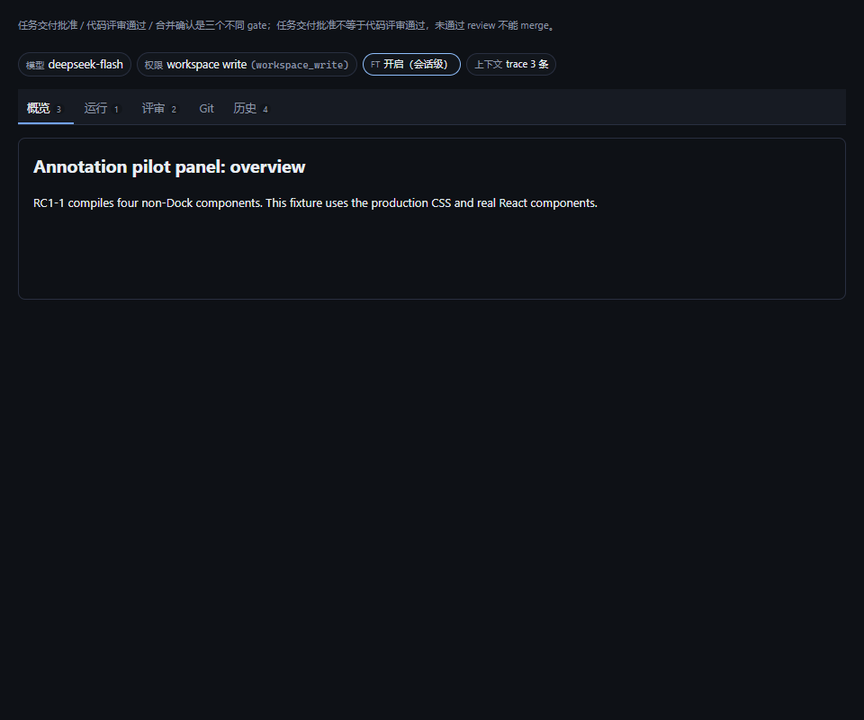
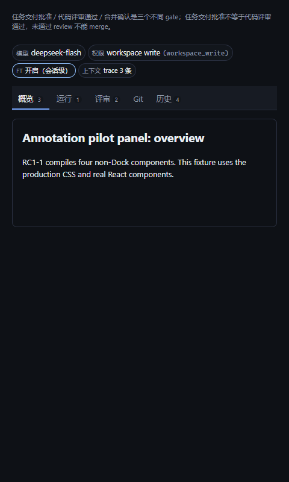

# RC1-1 React Compiler annotation 璇曠偣锛坱520锛?
## 1. 鑼冨洿涓庣粍浠?
鍦?RC1-0锛坮enderer-only 杈圭晫銆侀粯璁?build/test 涓嶇紪璇戯級涔嬩笂锛屾湰杞彧閫?**4 涓潪 Dock銆侀潪鍏抽敭銆佺函灞曠ず/杞讳氦浜掔粍浠?*锛屾樉寮忓姞鍏?`"use memo"`锛?
1. `src/shell/SkipLink.tsx`锛堟棤闅滅璺宠浆閾炬帴锛?2. `src/shell/ApprovalTerms.tsx`锛堝彧璇?gate 鏈璇存槑锛?3. `src/shell/TaskContractChips.tsx`锛堝彧璇绘墽琛屽绾?chips锛屽凡鏈夋祴璇曪級
4. `src/shell/TaskWorkspaceTabs.tsx`锛圓RIA tabs锛屽凡鏈夐敭鐩樻祴璇曪級

涓嶉€?Dock/PanelHost/LazyPanel/Chat/Task 涓诲伐浣滃尯/鏉冮檺/瀹℃壒缁勪欢锛涗笉鍒犻櫎浠讳綍鎵嬪伐 `useMemo`銆佷笉鏀逛笟鍔￠€昏緫/API/鐘舵€佹満/鏉冮檺/gate锛涙棤 runtime 渚濊禆銆?
## 2. 瀹炵幇

- 4 涓瘯鐐圭粍浠跺嚱鏁颁綋棣栬鍔?`"use memo"`锛沘nnotation 妯″紡鍙紪璇戝甫璇?directive 鐨勫嚱鏁般€?- `src/shell/reactCompilerBoundary.ts`锛?  - allowlist 浠?1 涓墿涓轰笂杩?4 涓紱
  - `reactCompilerMode()` 榛樿 **annotation**锛坄RC1_MODE=infer` 鍙樉寮忓垏 infer锛夛紱
  - 鍏朵粬杈圭晫涓嶅彉锛坘ernel/review/watchdog/memory/shared/electron/scripts/tests 鎺掗櫎锛沠ile-level `sources` guard锛夈€?- 榛樿 `pnpm build`/`pnpm test` 浠嶄笉缂栬瘧锛沗pnpm build:compiler`锛坄RC1_COMPILER=1`锛変笌 `pnpm test:compiler`锛坄VITEST_REACT_COMPILER=1`锛夋樉寮忓鐜般€?- 鏂板 `ApprovalTerms.test.tsx`銆乣reactCompilerPilot.test.ts`锛坉irective/allowlist 鏂█锛夛紱`test:compiler` 瑕嗙洊 4 涓瘯鐐圭浉鍏虫祴璇?+ boundary銆?
## 3. 鍗曞厓/浜や簰

- `pnpm test:compiler`锛?*6 鏂囦欢 / 12 鐢ㄤ緥鍏ㄧ豢**锛圫kipLink銆丄pprovalTerms銆乀askContractChips銆乀askWorkspaceTabs銆乥oundary銆乸ilot directive锛夈€?- 浜や簰锛堢湡瀹?Electron 缂栬瘧鐗?story锛夛細鐒︾偣 `#task-tab-overview` 鍚?ArrowRight 鈫?`task-tab-runs`锛宍aria-selected`/focus 鍧囨纭紱鏃犱笟鍔¤涓哄彉鍖栥€?- 缁勪欢 fixture 浣跨敤 production CSS/React 缁勪欢锛涗笉鎻愪氦 story harness锛涗粎鎻愪氦 screenshot/JSON銆?
## 4. 涓夋。鎴浘锛?440/960/480锛?
| 1440 | 960 | 480 |
|---|---|---|
|  |  |  |

- 涓夋。 `scrollWidth===innerWidth`锛?440/960/480锛夛紝鏃犳í鍚戣鍒囷紱ApprovalTerms 11px銆乀askContractChips 13px銆乼abs/active 鍐呭銆丼kipLink 淇濇寔銆?- 浜や簰鎴浘锛歚t520-annotation-interaction-1440.png`锛沗t520-annotation-walkthrough.json` 璁板綍 active/focus/灏哄銆?- fixture 鐢ㄧ湡瀹?Electron 鍔犺浇 compiled story锛涗笉浼О涓哄畬鏁?App Dock 鎴浘銆?
## 5. 鏋勫缓/鎬ц兘瀵规瘮

compiler story 涓庨粯璁?story 浣跨敤鍚屼竴缁勪欢/甯冨眬锛屽垎鍒瀯寤猴紱鐪熷疄 Electron 鍐?100 娆?mount/update 鍩哄噯锛坄flushSync`锛屽悓涓€ fixture锛夛細

| 鎸囨爣 | 榛樿锛堟棤 compiler锛?| annotation compiler | 鍙樺寲 |
|---|---:|---:|---:|
| 缁勪欢 render 100 娆?total | **32.5 ms** | **30.7 ms** | **-1.8 ms锛堢害 -5.5%锛?* |
| 骞冲潎 | **0.325 ms** | **0.307 ms** | -0.018 ms |
| story JS | 223,868 B / gzip 70.61 kB | 225,539 B / gzip 71.39 kB | **+1,671 B** |
| App `index` | 369.06 kB / gzip 109.86 | 370.58 kB / gzip 110.62 | **+1.52 kB** |
| `vendor-react` | 206.75 kB / gzip 64.81 | 206.92 kB / gzip 64.91 | **+0.17 kB** |
| CSS | 150.01 kB / gzip 25.44 | 150.01 kB / gzip 25.44 | 0 |
| Vite renderer | 259 ms | 733 ms | +474 ms |
| 鎬?build锛堝惈 electron锛?| 1038 ms | 1720 ms | +682 ms |

- 缁撴灉鍦ㄥ宸唴涓旀湭瑙傚療鍒板洖褰掞紱涓嶅洜璇ュ井灏忔敹鐩婂垹闄よ瘯鐐癸紝涔?*涓嶅绉?*缂栬瘧鍣ㄥ甫鏉ョǔ瀹氭€ц兘鎻愬崌銆?- 缂栬瘧杈撳嚭鍙樺寲鍙潵鑷?4 涓?directive 缁勪欢鐨?annotation 浠ｇ爜锛涢粯璁?build 浜х墿浠嶆槸鍩虹嚎锛坉irective 鏈韩涓嶆敼鍙樿涓猴級銆?- renderer sourcemap 閰嶇疆鏈敼锛堝叧闂級锛涙棤鏂板 runtime 渚濊禆銆?
## 6. 楠岃瘉涓庡洖婊?
- `pnpm typecheck` 鈫?0
- `pnpm build` 鈫?0锛堥粯璁ゆ棤 compiler锛?- `pnpm test` 鈫?**175 鏂囦欢 / 1137 鐢ㄤ緥鍏ㄧ豢**锛堜竴娆?openai 鏈湴 endpoint flake锛屽崟娴嬩笌鍏ㄩ噺閲嶈窇鍧囩豢锛?- `pnpm build:compiler` 鈫?0
- `pnpm test:compiler` 鈫?**6 鏂囦欢 / 12 鐢ㄤ緥鍏ㄧ豢**

鍥炴粴锛氬垹闄?4 澶?`"use memo"`銆佷粠 `REACT_COMPILER_ALLOWLIST` 绉婚櫎 4 涓矾寰勩€佹仮澶?`reactCompilerMode` 榛樿锛堝闇€锛夛紝鎴栦繚鎸?`RC1_COMPILER` 鏈缃紱榛樿 build/test 涓嶅彈褰卞搷銆傛棤 DB/浜嬩欢/鏉冮檺/IPC/鏁版嵁杩佺Щ銆?
## 7. 鍚庣画

RC1-2锛坰hell/git UI infer + opt-out锛夊啀鎵╁ぇ锛涙湰 PR 涓嶅垹闄ゆ墜宸?memo銆佷笉鏀逛笟鍔★紝涔熶笉鎻愬墠鍚敤榛樿缂栬瘧銆?

