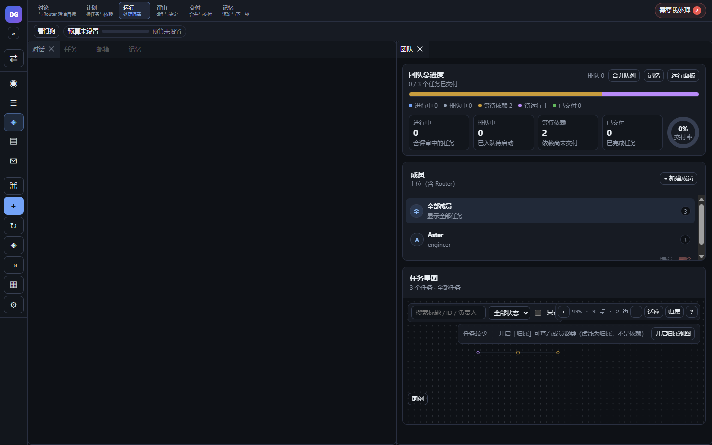
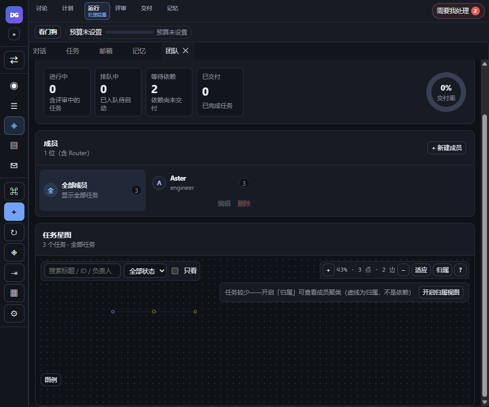
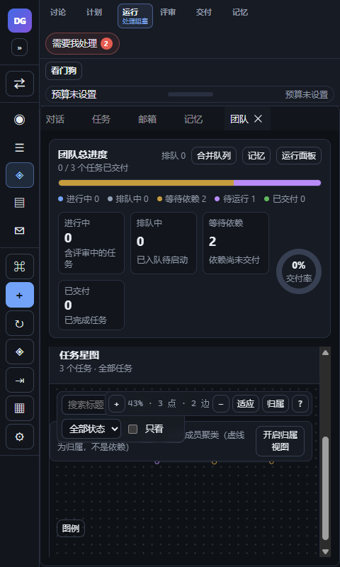

# G13 移除星图底部提示条（t454）

## 1. 功能与范围

删除星图底部的整块 `.star-hint` 提示条，以及 TeamDashboard 星图标题旁重复的「拖动空白平移 · 滚轮缩放」小字；帮助面板（`?`）、sr-only 状态、快捷键与星图交互全部保留。

- 分支：`feature/t454-starmap-hint-removed`（基于 main `0332b91`）。
- 仅 UI/CSS/测试/docs；不改 G6 单击/双击语义、数据源、权限、IPC、schema。
- 不新增占位：删除 JSX 后画布直接延伸到原有底部区域。

## 2. 变更

- `src/TaskStarMap.tsx`：删除底部 `
拖动空白平移 · … · Esc 退出聚焦
` 整块；保留 `?` 帮助按钮、帮助 Modal、sr-only 状态、画布键盘/指针处理。
- `src/TeamDashboard.tsx`：删除星图区标题右侧重复小字 `拖动空白平移 · 滚轮缩放`；任务计数/成员过滤摘要保留。
- `src/styles.css`：删除 `.star-hint` 绝对定位/背景/字号规则；从 `.star-zoom, .star-hint` 组合规则中移除 `.star-hint`，`.star-zoom` 样式保留。
- `src/TaskStarMap.click.test.tsx`：
  - 新增「已移除底部 star-hint，保留 ? 帮助与 sr-only 状态」：断言 `.star-hint` 节点 0、完整提示文案不存在、`title="星图帮助"` 按钮存在、`.sr-only` 存在。
  - TeamDashboard 星图布线测试增加不包含 `拖动空白平移 · 滚轮缩放` 的断言。
  - 原有 G6 单击/双击/Ctrl+Enter/浮窗动作测试保持不变。

## 3. 真实 Electron 验证

真实 Electron（隔离 `--user-data-dir` + t419 星图 fixture：3 节点依赖链），CDP 三档 viewport + 显式 resize：

| 1440 星图 | 960 星图 | 480 星图 |
|---|---|---|
|  |  |  |

`t454-walkthrough.json`：**14/14 PASS**

- 1440/960/480：`.star-hint` 节点 0、完整旧提示文案不存在、TeamDashboard 重复小字不存在。
- 三档均保留 `?`（`title="星图帮助"`）与 `.sr-only`；帮助面板可打开。
- 3 个 `data-star-node` 均渲染；`scrollWidth === innerWidth`（1440/960/480），无横向溢出。

## 4. 验证

- `pnpm typecheck` exit 0。
- `pnpm build` exit 0（js 328.12 kB / gzip 97.88；vendor 414.89 / 97.22）。
- `pnpm test -- --max-workers=1 --testTimeout=20000`：137 文件 / 962 用例全绿（exit 0）。

## 5. 风险与回滚

- 删除纯视觉提示，不删除任何快捷键/功能；帮助面板仍提供完整手势表。
- G6 单击只弹概览、双击/Ctrl+Enter 进任务路径未改；由原 7 项 click 测试覆盖。
- 回滚：revert 本 PR 单 commit 即可恢复提示条与 CSS。

