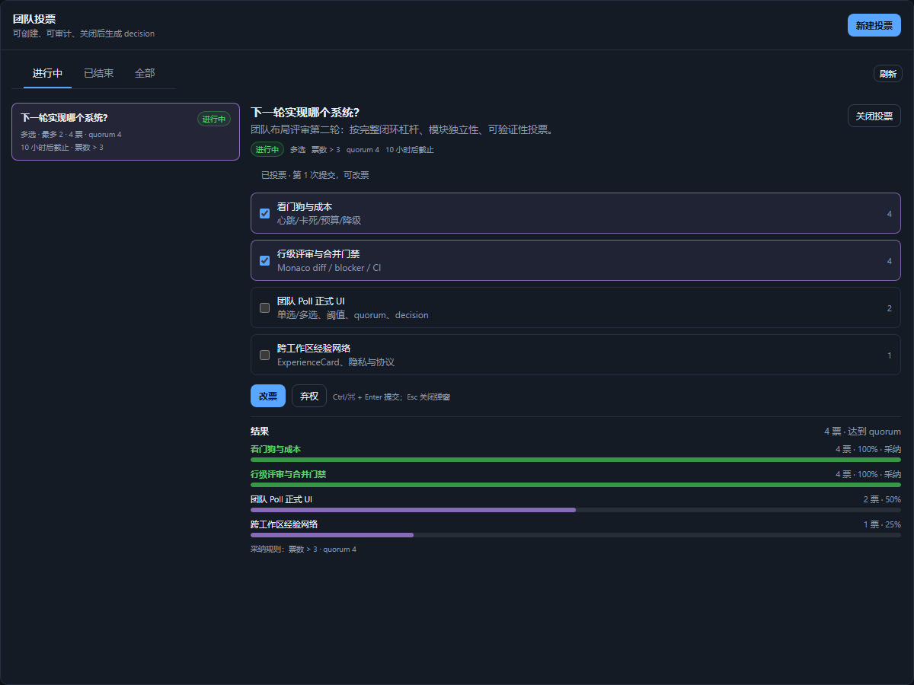

# 团队投票（Poll）实现记录（t136）

> 基线：`DESIGN.md` §14。范围：Poll 数据、API/IPC、Dock UI、decision 落库与审计；不包含 watchdog、review gate、MCP 等其它系统。

## 1. 交付范围

- `polls` / `poll_options` / `poll_ballots` / `poll_decisions` 四张表，随 `Store` 的 `SCHEMA` 以 `CREATE TABLE IF NOT EXISTS` 增量创建；旧库重新打开即自动补表，不需要数据回填。
- 单选/多选、`maxSelections`（`null` = 不限）、`thresholdRule`（`gt` / `majority` / `percent`）、`thresholdValue`、`quorum`、`allowAbstain`、`anonymous`、`closesAt`、`status`、`decisionRef`。
- `poll.create` / `poll.list` / `poll.get` / `poll.cast` / `poll.close` 的 Store、AppService、Electron IPC、preload、`DeerApi` 链路。
- Dock 面板 `polls`（默认关闭，可从侧栏「面板」启动器与命令面板打开）、创建 Modal、投票卡、结果条、quorum/阈值/截止倒计时、decision 展示。

> 截图为本地面板预览（mock 数据，非生产 workspace）；真实投票/decision 由 Store + IPC 提供。
- 任务详情与黑板条目提供「发起投票」入口；从来源进入时预填标题、scope 与第一个候选来源。
- 审计事件：`poll.created` / `poll.voted` / `poll.closed` / `poll.decided` / `poll.expired`；事件使用 Store 事件日志，`poll.voted` 只记录 voter 类型、选择数、revision，不写候选正文。

## 2. 业务规则

- **创建即开放**：P0 创建后 `status=open`（DESIGN 的 draft/`poll.open` 人工确认留到 P1）。创建校验标题、2–50 个候选、候选长度、单一/多选上限、阈值、quorum、未来截止时间。
- **投票校验**：poll 必须 `open` 且未过 `closesAt`；`voterType=human` 接受本地人类 voter，`voterType=agent` 必须是同 workspace 的 agent；选项必须属于该 poll；`single` 最多 1 项，`multi` 不超 `maxSelections`；不允许弃权时不能提交空选择。
- **一 voter 一 ballot**：`poll_ballots` 对 `(poll_id, voter_id)` 唯一；重复提交是改票，保留同一 ballot 并递增 `revision`；完全相同选择按幂等处理，不新增事件。
- **关闭权限**：创建者、`facilitator`、`admin` 或本地 `user` 可关闭；重复 close 返回同一 decision，不重复写事件。
- **结果规则**：
  - `gt`：票数 > `thresholdValue`；
  - `majority`：票数 > 总 ballot 的 50%；
  - `percent`：票数 / 总 ballot ≥ `thresholdValue`%；
  - 只有达到 quorum 的 poll 才标记采纳项；quorum 未达到时 `insufficientQuorum=true`、`adoptedOptionIds=[]`，仍写一条可审计 decision 记录但不生成黑板 decision 条目。
- **decision 落库**：close 时总是写 `poll_decisions`；有采纳项时同时通过既有 `Store.postBoard` 写入 `decisions` 黑板条目，并把条目 id 存入 `decision_ref` / `poll_decisions.board_entry_id`。decision summary 含 poll 标题、采纳候选与票数；无采纳时说明原因。
- **匿名**：`anonymous` 只影响展示层；审计 ballot 仍保留 voter；UI 不展示 ballot 身份列表。

## 3. 代码入口

| 层 | 文件 |
|---|---|
| 类型/纯规则 | `src/shared/poll.ts`（normalize、selection、evaluate、expiry、decision summary） |
| 持久化 | `src/kernel/store.ts`（poll 表、create/list/get/cast/close、映射、事件、decision 黑板条目） |
| 服务 | `src/kernel/service.ts`（AppService wrapper） |
| IPC | `src/shared/ipc.ts`、`electron/main.ts`、`electron/preload.ts` |
| UI | `src/shell/PollPanel.tsx`、`src/styles.css`、`src/shell/dock/panelRegistry.ts`、`src/App.tsx`、`src/CommandPalette.tsx` |
| 入口 | Dock 侧栏/命令面板；Task 详情；MemoryWorkbench 黑板卡片 |

## 4. 可访问性与交互

- 创建 Modal 复用既有 `Modal`：Esc 关闭、焦点陷阱、`aria-modal`、未保存内容确认；表单内 `Ctrl/⌘ + Enter` 提交。
- 选项使用原生 radio/checkbox，放在 `fieldset` 中；结果使用 `role="list"`，票数条使用 `role="progressbar"` + `aria-valuenow`。
- 投票/改票/关闭/错误通过 `role="status"` + `aria-live="polite"` 与全局 toast 反馈；空态/错误态有明确文案与重试/创建动作。
- 窄窗通过 `@media (max-width: 900px)` 切为单列，候选行折叠；Poll 面板默认关闭，不改变默认 Dock 布局。

## 5. 测试与验证

- `src/shared/poll.test.ts`：输入归一化、single/multi/maxSelections、弃权、gt/majority/percent、quorum、截止、无采纳 summary。
- `src/kernel/poll.test.ts`：建表/创建、单选/多选校验、重复投票/改票 revision、`>3` 采纳 + decision 黑板 + close 幂等、quorum 缺失、关闭权限、deadline/closed cast 拒绝、事件。
- `src/shell/PollPanel.test.tsx`：status/threshold/countdown 文案、结果条/aria progressbar/quorum/decision 空态。
- 命令：`pnpm typecheck`、`pnpm build`、`pnpm test`。
- 实测：typecheck 0；build 0；`pnpm test` 35 文件 / 453 条全绿（Poll 新增 14 条：store 7、规则 4、UI 3）。

## 6. 已知边界 / 下一轮

- P0 创建即开放；draft + 人类确认 open 留到 P1。
- `majority` 与 `percent` 以 ballot 数为分母（弃权也计入 quorum/分母），未做加权票/角色票。
- 关闭时 quorum 未达到仍保留一条 decision 审计记录（flag `insufficient_quorum=1`），但不产生采纳项、不写黑板 decision；这是对 DESIGN §14.2「不产生 decision」的可审计化实现，若要求完全不落 decision 行可在 P1 调整。
- 投票人目前是本地单用户 `user` + 同 workspace agent；跨工作区投票/角色权重/导出审计报告不在本 PR。
- UI 仅提供本地单用户视角；多用户实时协同留到 Hub 阶段。
